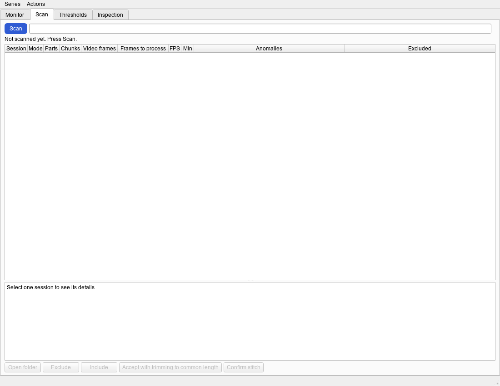
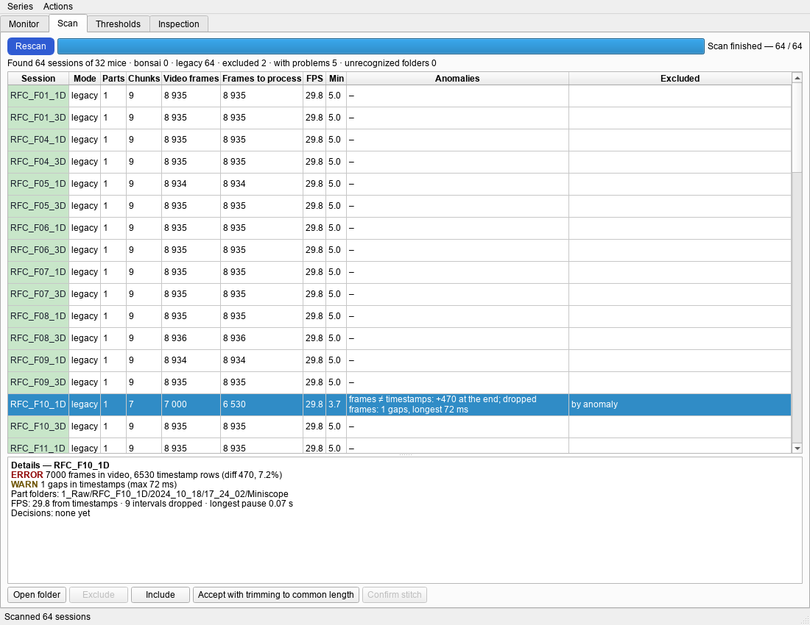
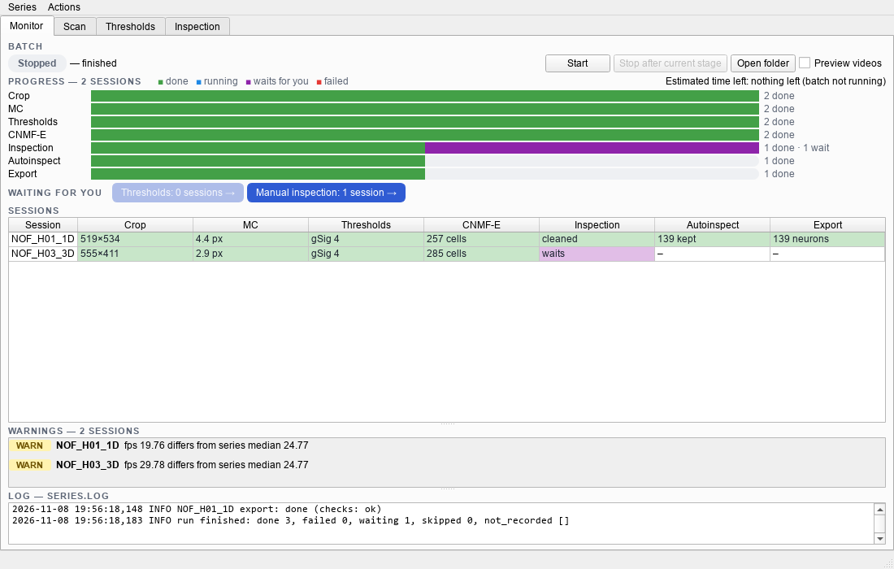
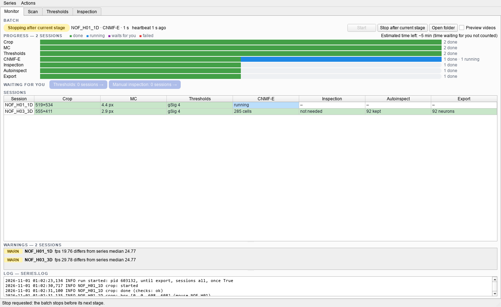
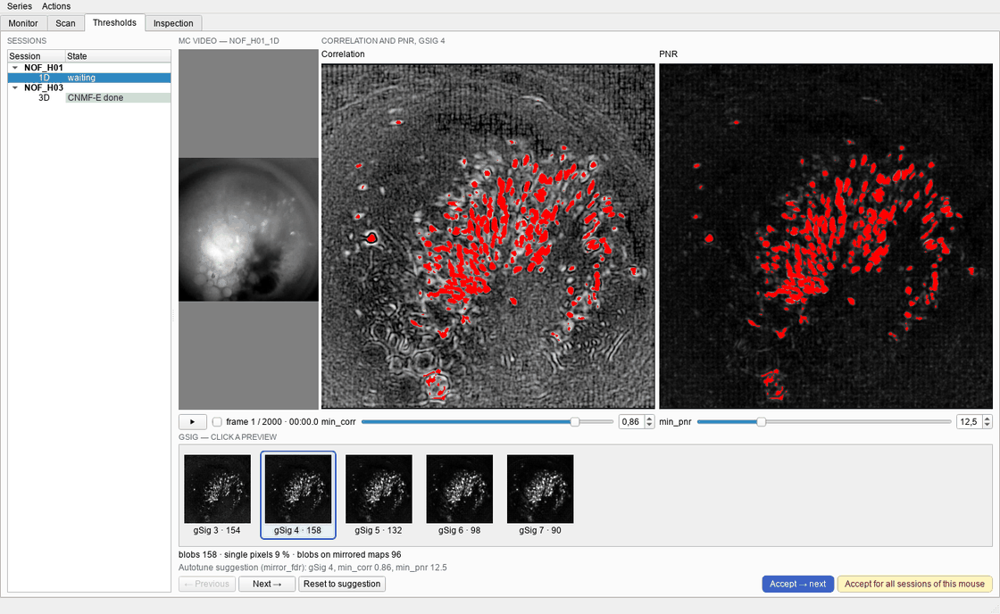

# BEARMiND: работа с серией

Эта инструкция ведёт серию записей от сырых видео до экспорта. Установка описана в [README.md](README.md).

Как читать инструкцию. **Жирным** написаны названия из окна программы: вкладки, кнопки, меню, столбцы. `Моноширинным` шрифтом написаны файлы, папки, команды и тексты в ячейках таблиц. Вместо `<SID>` подставьте имя сессии, например `NOF_H01_1D`.

Слова инструкции:

- ячейка — поле таблицы в окне;
- клетка — клетка мозга;
- компонента — то, что нашёл CNMF-E: кандидат в клетки;
- нейрон — компонента, которую оставили автоинспекция и экспорт;
- сводка — таблица сессий в окне и файл `summary.csv`.

## Окно и батч

У окна BEARMiND четыре вкладки: **Monitor**, **Scan**, **Thresholds**, **Inspection**.

- **Monitor** показывает батч, этапы и все сессии серии.
- **Scan** находит сессии в папке серии и показывает аномалии записей.
- **Thresholds** нужна, чтобы выбрать пороги CNMF-E для каждой сессии.
- **Inspection** открывает ручную инспекцию сессии в браузере.

Батч — отдельный процесс. Он ведёт каждую сессию через семь этапов. Каждый этап — столбец таблицы на вкладке **Monitor**.

| Этап | Что делает |
|---|---|
| **Crop** | ставит рамку кропа на поле зрения |
| **MC** | исправляет движение ткани; пишет видео `3_MC/<SID>_MC.avi` |
| **Thresholds** | строит карты корреляции и PNR, потом ждёт ваших порогов |
| **CNMF-E** | находит компоненты и их трейсы |
| **Inspection** | ждёт вашего решения: ручная инспекция или отказ от неё |
| **Autoinspect** | автоинспекция: убирает плохие компоненты и сливает дубли |
| **Export** | пишет нейроны и их трейсы в папку `6_Export` |

Батч идёт по серии этап за этапом: сначала **Crop** всех сессий, потом **MC** всех сессий, и так далее. В каждый момент он делает один этап одной сессии. Самый ранний этап, который можно сделать, всегда идёт первым.

Батч ждёт вас на двух этапах: **Thresholds** и **Inspection**. Пока сессия ждёт, батч работает с другими сессиями. Если батчу больше нечего делать, он берёт ваше решение в течение 30 секунд. Если батч занят, решение ждёт, пока он не сделает более ранние этапы других сессий. Перезапускать батч не нужно.

Батч никогда не останавливается из-за одной сессии. Если этап сессии упал, остальные сессии идут дальше.

## Содержание

1. [Папка серии](#1-папка-серии)
2. [Вкладка Scan: найти сессии, разобрать аномалии](#2-вкладка-scan-найти-сессии-разобрать-аномалии)
3. [Запуск батча на вкладке Monitor](#3-запуск-батча-на-вкладке-monitor)
4. [Вкладка Thresholds](#4-вкладка-thresholds)
5. [Manual inspection или Not needed](#5-manual-inspection-или-not-needed)
6. [Сводка: исключить сессию, пересчитать](#6-сводка-исключить-сессию-пересчитать)
7. [Цвета ячеек и три частых предупреждения](#7-цвета-ячеек-и-три-частых-предупреждения)
8. [Если что-то пошло не так](#8-если-что-то-пошло-не-так)
9. [Тонкие настройки](#9-тонкие-настройки)

## 1. Папка серии

Серия — одна папка. Сырые видео лежат в ней в папке `1_Raw`. Остальные папки создаёт программа.

| Папка | Что внутри | Кто пишет |
|---|---|---|
| `1_Raw` | сырые видео сессий | вы; программа только читает |
| `0_TimeStamps` | таймстемпы, если они лежат отдельно от видео | вы |
| `3_MC` | видео после кропа и MC, сдвиги MC | батч |
| `4_Estimates` | результат CNMF-E | батч |
| `5_Inspection` | результат ручной инспекции и автоинспекции | страница инспекции, батч |
| `6_Export` | результат обработки: файлы NPZ и JSON, таймстемпы, контуры MAT | батч |
| `Preview` | видео и картинки для проверки | батч |
| `_bearmind` | конфиги, реестр сессий, логи, сводка `summary.csv` | программа |

Программа никогда не пишет в `1_Raw` и `0_TimeStamps`. Ваши сырые данные остаются как есть.

Имя сессии — `ЭКСПЕРИМЕНТ_МЫШЬ_ДЕНЬ`, например `NOF_H01_1D`. Мышь этой сессии — `NOF_H01`. Программа узнаёт сессии по таким именам.

Программа сама узнаёт два вида записи:

- bonsai: папка `1_Raw/<SID>` с видео `<SID>_1.avi`, `<SID>_2.avi` и таймстемпами `<SID>_Mini_TS.csv`. Таймстемпы могут лежать и в `0_TimeStamps`. Папки сессий могут быть сгруппированы: `1_Raw/<группа>/<SID>`.
- legacy (программа UCLA Miniscope): видео и файл таймстемпов лежат в папке `1_Raw/<SID>/<дата>/<время>/Miniscope`.

Подготовьте серию:

1. Создайте папку серии на диске с данными.
2. Создайте в ней папку `1_Raw`.
3. Скопируйте папки сессий в `1_Raw`.
4. Если таймстемпы лежат отдельно, скопируйте их в папку `0_TimeStamps`.

**Не удаляйте** видео MC (`3_MC/<SID>_MC.avi`), чтобы освободить место на диске. Без него батч заново сделает MC и все следующие этапы сессии. Ручную инспекцию сессии тоже придётся повторить.

## 2. Вкладка Scan: найти сессии, разобрать аномалии

Сначала откройте серию в окне.

1. Дважды щёлкните `bearmind_gui.bat` в папке репозитория.
2. Откройте меню **Series**.
3. Выберите **Open series…**.
4. Выберите папку серии в окне выбора папки.

Меню **Recent** хранит последние открытые серии.

Найдите сессии:

1. Откройте вкладку **Scan**.
2. Нажмите **Scan**.
3. Дождитесь надписи `Scan finished` справа от полосы.
4. Прочитайте строку итога под кнопкой: сколько сессий найдено, исключено и с проблемами.

Поиск 112 сессий занимает около 10 секунд. После первого поиска кнопка называется **Rescan**. Нажимайте **Rescan**, когда добавили сессии в `1_Raw` или исправили файлы.

**Внимание.** Пока идёт батч, нажимайте **Rescan**, только если это нужно. Этапы сессий с изменёнными файлами батч пересчитает. Программа спросит подтверждение.

### Таблица и подробности

Одна строка таблицы — одна сессия. Цвет ячейки с именем сессии показывает худшую аномалию: зелёный — нет проблем, жёлтый — предупреждение, красный — ошибка. Столбец **Anomalies** перечисляет аномалии кратко. Столбец **Excluded** говорит, кто исключил сессию: `by anomaly` (программа) или `by you` (вы).

Выделите сессию: панель **Details** под таблицей покажет все её аномалии. Строка `ERROR` — ошибка, `WARN` — предупреждение, `INFO` — сведения. Зелёная строка `FIXED` — программа исправила сама, делать ничего не нужно.

Сессию с ошибкой (`ERROR`) программа исключает сама. Батч исключённую сессию пропускает.

| Аномалия | Что значит | Что делать |
|---|---|---|
| `frames ≠ timestamps` | кадров в видео больше или меньше, чем строк таймстемпов | если разница в конце, нажмите **Accept with trimming to common length**; иначе спросите руководителя |
| `split recording` | запись из нескольких частей; программа склеила их по времени начала | проверьте части в **Details**, нажмите **Confirm stitch** |
| `no timestamps found` | нет файла таймстемпов | положите файл в папку сессии или в `0_TimeStamps`, нажмите **Rescan** |
| `FPS outlier` | частота кадров не такая, как у других сессий мыши | проверьте частоту в **Details**; спросите руководителя, если не понимаете причину |
| `dropped frames` | паузы между кадрами в таймстемпах | обычно ничего; при длинных паузах спросите руководителя |

### Принять несовпадение кадров

Программа отрежет лишние кадры или строки таймстемпов в конце. Файлы в `1_Raw` не меняются.

1. Выделите сессию в таблице.
2. Прочитайте строку `ERROR` в панели **Details**.
3. Нажмите **Accept with trimming to common length**.
4. Подтвердите выбор в окне вопроса.

### Исключить сессию и вернуть её

1. Выделите сессию в таблице.
2. Нажмите **Exclude**.
3. Подтвердите выбор в окне вопроса.

Чтобы вернуть сессию, выделите её и нажмите **Include**. **Include** работает только для сессий, которые исключили вы (`by you`). Сессию, которую исключила аномалия, верните так: исправьте файлы и нажмите **Rescan**.

Папки, в которых программа не нашла сессий, перечислены в списке **Unrecognized folders** под таблицей. Двойной щелчок открывает папку. Проверьте имя папки и её устройство, потом нажмите **Rescan**.

## 3. Запуск батча на вкладке Monitor

**Внимание.** Запускайте на машине только один батч. Два батча не помещаются в память, поэтому **Start** откажет, если идёт батч другой серии.

1. Откройте вкладку **Monitor**.
2. Нажмите **Start**.
3. Проверьте, что слева вверху появилась надпись **Running**.

Надпись слева вверху показывает состояние батча:

| Надпись | Что значит |
|---|---|
| **Running** | батч идёт; рядом сессия, этап и время этапа |
| **Stopping after current stage** | вы нажали стоп; батч доделывает текущий этап |
| **Stopped** | батч не идёт; рядом причина, например `finished` или `stop requested` |
| **Not responding** | процесс батча пропал без остановки, например после перезагрузки; см. раздел 8 |

Окно можно закрыть: батч идёт без окна. Откройте окно и серию снова, чтобы посмотреть ход работы.

Полосы **Progress** показывают каждый этап по всем сессиям. Справа — оценка оставшегося времени. Время, пока сессии ждут вас, в оценку не входит.

Строка **Waiting for you** показывает, сколько сессий ждут вас. Кнопка **Thresholds** открывает вкладку **Thresholds** на первой ждущей сессии. Кнопка **Manual inspection** открывает вкладку **Inspection** и выделяет первую ждущую сессию.

### Остановить батч

1. Нажмите **Stop after current stage**.
2. Дождитесь надписи **Stopped**.

Батч сначала доделает текущий этап. CNMF-E длинной сессии идёт долго, поэтому остановка может занять время. Готовые этапы сохраняются. **Start** продолжит с того же места.

Флажок **Preview videos** включает видео для проверки MC и CNMF-E. По умолчанию он выключен: видео часовой сессии делаются около часа. Подробности — в [заметках оператора](../superpowers/specs/2026-11-01-operator-notes.md#превью).

## 4. Вкладка Thresholds

CNMF-E ищет компоненты по трём порогам. `gSig` — ожидаемый размер клетки. `min_corr` и `min_pnr` — нижние границы корреляции и отношения пика к шуму (PNR) пикселя. Батч ждёт порогов каждой сессии: в столбце **Thresholds** стоит `waits`.

Что на вкладке:

- слева — список сессий по мышам и их состояние (**State**): `waiting` ждёт порогов, `chosen` пороги выбраны;
- в середине — **MC video**, видео сессии после MC;
- справа — карты **Correlation** и **PNR**; красным отмечены пиксели, которые проходят оба порога;
- внизу — превью для каждого `gSig` с числом пятен;
- под превью — счётчики: `blobs` (пятна), `single pixels` (доля одиночных пикселей), `blobs on mirrored maps` (пятна на картах фильма с обратным знаком, где настоящих клеток нет);
- строка источника: `Autotune suggestion` — подсказка автоподбора порогов.

**Внимание.** Не меняйте без нужды пороги сессии, у которой CNMF-E уже готов. Новые пороги запустят CNMF-E заново, и ручную инспекцию придётся повторить. Программа спросит об этом: если не уверены, нажмите **Cancel**.

1. Нажмите кнопку **Thresholds** в строке **Waiting for you** на вкладке **Monitor**.
2. Запустите видео MC кнопкой ▶.
3. Посмотрите, как выглядят клетки на видео.
4. Щёлкните превью `gSig`, на котором клетки видны лучше всего.
5. Подвиньте ползунок **min_corr**, чтобы красные пятна легли на клетки.
6. Подвиньте ползунок **min_pnr** так же.
7. Нажмите **Accept → next**.

Программа запишет пороги и откроет следующую ждущую сессию. Строка состояния внизу окна подтвердит запись. На вкладке **Monitor** ячейка **Thresholds** покажет `gSig <N>`. Ячейка **CNMF-E** покажет `–` без цвета, пока батч не дойдёт до CNMF-E этой сессии.

Если **Accept → next** неактивна, причина написана на месте карт и в подсказке кнопки. Пример: `The maps are out of date: the batch redoes … first.` Тогда батч сначала пересчитает более ранние этапы. Выберите пороги, когда сессия снова будет ждать.

Кнопка **Reset to suggestion** возвращает ползунки к подсказке автоподбора. Кнопки **← Previous** и **Next →** листают сессии без записи.

### Одни пороги для всех сессий мыши

Кнопка **Accept for all sessions of this mouse** пишет пороги во все сессии мыши, у которых порогов ещё нет. Исключённые сессии она не трогает.

1. Выберите пороги на одной сессии мыши.
2. Нажмите **Accept for all sessions of this mouse**.
3. Прочитайте в вопросе список сессий, которые получат пороги.
4. Нажмите **Write**.

## 5. Manual inspection или Not needed

После CNMF-E сессия ждёт вашего решения: в столбце **Inspection** стоит `waits`. Решений два:

- **Manual inspection**: вы смотрите компоненты в браузере, удаляете плохие и сливаете дубли. Решение записывается как `cleaned`.
- **Not needed**: батч берёт результат CNMF-E как есть. Решение записывается как `not needed`.

После любого решения батч сам делает автоинспекцию и экспорт. Каким сессиям нужна ручная инспекция, решите с руководителем.

### Ручная инспекция

Страница инспекции открывается в браузере. Окно BEARMiND в это время свободно.

**Внимание.** Не открывайте заново без нужды сессию с решением `cleaned`. Страница покажет результат CNMF-E, а не ваш сохранённый результат. Новое **Save results** заменит старый результат, и батч заново сделает автоинспекцию и экспорт.

1. Откройте вкладку **Inspection**.
2. Выделите одну сессию, у которой в столбце **Inspection** стоит `waits`.
3. Нажмите **Manual inspection**.
4. Дождитесь страницы сессии в браузере. Первый запуск занимает около 10 секунд, большие сессии открываются дольше.
5. Выделите в списке компоненту, которая не похожа на клетку.
6. Нажмите **Delete sel.**
7. Выделите две компоненты, которые на самом деле одна клетка.
8. Нажмите **Merge sel.**
9. Повторите шаги 5–8 для остальных компонент.
10. Нажмите **Save results**.
11. Проверьте надпись `Saved. Decision “cleaned” recorded for <SID>. You can close this tab.`
12. Нажмите кнопку **Next** с именем следующей сессии.

**Save results** сохраняет результат и записывает решение `cleaned`. **Next** открывает следующую ждущую сессию, примерно за секунду. Если ждущих сессий больше нет, страница пишет `No more sessions wait for manual inspection.`

Если **Manual inspection** неактивна, наведите на неё мышь: подсказка назовёт причину. Пример: `CNMF-E of <SID> is out of date: the batch recomputes it first.` Тогда откройте сессию после нового CNMF-E.

Другие кнопки страницы:

| Кнопка | Что делает |
|---|---|
| **Revert change** | отменяет последнее удаление или слияние |
| **Discard all** | отменяет все изменения на странице |
| **Save progress** | сохраняет промежуточную копию без решения в папку `5_Inspection/<SID>/progress`; открыть эту копию на странице нельзя |

Одну сессию можно открыть только в одной вкладке браузера. Сервер страницы закрывается сам через 10 минут после закрытия последней вкладки.

### Перезагрузка страницы

**Внимание.** Не перезагружайте страницу (F5), пока на ней есть несохранённые изменения. Перезагрузка отбрасывает все несохранённые изменения.

После **Next** адрес страницы не меняется: в нём остаётся первая сессия этой вкладки. Поэтому F5 после **Next** снова откроет первую, уже сохранённую сессию. Чтобы открыть следующую сессию после перезагрузки, выберите её на вкладке **Inspection** окна BEARMiND. Кнопку браузера «Назад» для этого не используйте.

### После решения

После решения ячейка **Inspection** сессии меняется с `waits` на `–` без цвета. Так ячейка стоит, пока батч не дойдёт до этапа Inspection этой сессии. Потом в ней появится `cleaned` или `not needed`, и батч сделает автоинспекцию и экспорт. Если батч остановлен, нажмите **Start** на вкладке **Monitor**.

Жёлтая полоса `Looks like a calcium wave` над страницей — подсказка: в сессии, возможно, кальциевая волна. Это не ошибка. Покажите такую сессию руководителю.

### Ручная инспекция не нужна

1. Откройте вкладку **Inspection**.
2. Выделите сессии, которым ручная инспекция не нужна.
3. Нажмите **Not needed**.
4. Подтвердите выбор в окне вопроса.

То же делают пункты меню **Actions** на вкладке **Monitor**: **Inspection not needed (selected)** и **Inspection not needed for all waiting**.

## 6. Сводка: исключить сессию, пересчитать

Таблица **Sessions** на вкладке **Monitor** — сводка серии. Та же таблица лежит в файле `_bearmind/summary.csv`. Батч обновляет файл после каждого этапа. Команда `run_bearmind.bat status <папка серии>` тоже пишет этот файл.

Действия над сессиями — в меню **Actions**. То же меню открывается правым щелчком по таблице.

| Пункт меню | Что делает |
|---|---|
| **Exclude** | исключает выделенные сессии: батч их пропускает |
| **Include** | возвращает сессии, которые исключили вы |
| **Accept frame mismatch** | принимает несовпадение кадров, как на вкладке **Scan** |
| **Rerun from stage…** | пересчитывает выделенные сессии с выбранного этапа |
| **Retry failed (selected or all)** | повторяет упавшие этапы |
| **Inspection not needed (selected)** | записывает решение `not needed` для выделенных сессий |
| **Inspection not needed for all waiting** | то же для всех сессий, которые ждут ручной инспекции |
| **Export summary CSV…** | сохраняет копию сводки в выбранный файл |

### Исключить сессию

1. Выделите сессии в таблице **Sessions**.
2. Откройте меню **Actions**.
3. Выберите **Exclude**.
4. Подтвердите выбор в окне вопроса.

### Пересчитать с этапа

**Внимание.** Выбирайте этап **CNMF-E** или более ранний, только если это нужно. CNMF-E посчитается заново, и ручную инспекцию этих сессий придётся повторить.

1. Выделите сессии в таблице **Sessions**.
2. Откройте меню **Actions**.
3. Выберите **Rerun from stage…**.
4. Выберите этап в списке.
5. Нажмите OK.
6. Подтвердите выбор в окне вопроса.
7. Если батч не идёт, нажмите **Start**.

Старые результаты остаются, пока не готовы новые.

## 7. Цвета ячеек и три частых предупреждения

Наведите мышь на ячейку таблицы: подсказка покажет подробности этапа.

| Цвет ячейки | Что значит | Пример текста |
|---|---|---|
| зелёный | этап готов, проверки в норме | `512×480`, `3.5 px`, `230 cells`, `98 neurons` |
| жёлтый | этап готов, но есть предупреждение; или этап прерван | `18.0 px`, `19 neurons`, `interrupted` |
| красный | этап упал, или сессию нельзя поставить в работу | `failed` |
| синий | этап идёт | `running` |
| фиолетовый | этап ждёт вас | `waits` |
| без цвета | этап ещё не начат, или батч переделает этот результат | `–`, `out of date` |
| серый текст | сессия исключена | `–` |

В ячейке **CNMF-E** число `cells` — это число компонент. В ячейке **Export** число `neurons` — это число нейронов.

Те же цвета у полос **Progress**: зелёный — готово, синий — идёт, фиолетовый — ждёт вас, красный — упало.

Панель **Warnings** под таблицей перечисляет предупреждения. В заголовке — число сессий с предупреждениями. Предупреждения не останавливают батч. Строка предупреждения начинается с `ERROR` или `WARN`, потом идут сессия и этап. Три частых предупреждения:

| Предупреждение | Что значит | Что делать |
|---|---|---|
| `WARN` без этапа, например `fps 19.8; other sessions of the mouse: 29.8` | аномалия записи, найденная при поиске сессий | прочитайте **Details** сессии на вкладке **Scan**; если сессию записали с другой частотой намеренно, ничего не делайте |
| `ERROR` на этапе, текст кончается на `Other sessions continue.`, рядом кнопка **Retry** | этап упал | см. раздел 8, «Этап упал» |
| `WARN` на этапе **MC**: `max shift … px` и `Check the MC video on the Thresholds tab.` | сильное движение ткани | посмотрите **MC video** сессии на вкладке **Thresholds**; если клетки дрожат, покажите сессию руководителю |

Реже бывают: число компонент CNMF-E намного больше медианы серии, большая доля компонент удалена автоинспекцией, мало нейронов в экспорте. Покажите такие сессии руководителю.

## 8. Если что-то пошло не так

### Батч упал или машину перезагрузили

Надпись слева вверху — **Not responding** или **Stopped**. Ячейка прерванного этапа — жёлтая, `interrupted`.

1. Откройте окно BEARMiND и серию.
2. Нажмите **Start** на вкладке **Monitor**.

Батч продолжит с того места, где остановился. Прерванный этап начнётся сначала. Готовые этапы батч не повторяет.

### `summary.csv` открыт в Excel

Это нормально: батч продолжает работу. Пока Excel держит файл, батч не может обновить `summary.csv` и пишет об этом одно предупреждение в лог. Закройте Excel: файл обновится после следующего этапа. Чтобы смотреть сводку, не держа файл, сохраните копию через **Export summary CSV…**.

### Этап упал

**Внимание.** Не освобождайте место на диске удалением видео MC. Без видео MC батч повторит MC, CNMF-E и все следующие этапы сессии.

1. Выделите сессию в таблице **Sessions**.
2. Прочитайте лог сессии в панели **Log** внизу вкладки.
3. Устраните причину, например освободите место на диске.
4. Нажмите **Retry** в строке предупреждения.
5. Если батч не идёт, нажмите **Start**.

**Retry** повторяет упавший этап и все следующие. Старые результаты остаются, пока не готовы новые. Чтобы повторить все упавшие сессии сразу, выберите в меню **Actions** пункт **Retry failed (selected or all)** без выделения.

Если процесс этапа упал, батч сам повторяет этап один раз. Остальные сессии идут дальше в любом случае.

### **Start** не запустил батч

Причина появляется в строке состояния внизу окна:

| Текст | Что делать |
|---|---|
| `another batch is running on this machine: … run one batch at a time` | на машине уже идёт батч другой серии; дождитесь его конца или остановите его |
| `batch already running: PID …` | батч этой серии уже идёт, например из другого окна |
| `The batch did not start; see _bearmind/logs/runner_console.log` | откройте этот лог и покажите его руководителю |

### Страница инспекции

| Текст на странице | Что делать |
|---|---|
| `<SID> is already open in another browser tab.` | закройте другую вкладку с этой сессией |
| `Result is outdated: …` | CNMF-E сессии посчитан заново или считается сейчас; результат не сохранён. Откройте сессию снова, когда CNMF-E будет готов |
| `Changed since the last save: press Save results again.` | нажмите **Save results** ещё раз |

Если сервер страницы не запустился, вкладка **Inspection** назовёт лог одним из двух текстов:

- `The inspection server did not start; see _bearmind/logs/inspect_console.log`;
- `The inspection server did not start: …; details in gui.log` — файл `~/.bearmind/gui.log`.

### Где логи

Панель **Log** на вкладке **Monitor** показывает лог выделенной сессии. Если сессия не выделена, панель показывает лог серии.

| Файл | Что в нём |
|---|---|
| `_bearmind/logs/series.log` | лог серии: этапы всех сессий, сервер инспекции |
| `_bearmind/logs/<SID>.log` | лог одной сессии |
| `_bearmind/logs/runner_console.log` | вывод процесса батча |
| `_bearmind/logs/inspect_console.log` | вывод сервера инспекции |
| `~/.bearmind/gui.log` | ошибки окна BEARMiND |

Покажите руководителю лог и время, когда случилась ошибка.

## 9. Тонкие настройки

Тонкие настройки описаны в [заметках оператора](../superpowers/specs/2026-11-01-operator-notes.md): рамка кропа, видео для проверки, понижение фона CNMF-E, размер пула MC, один батч на машину. Там же объяснено, почему нельзя удалять видео MC.
