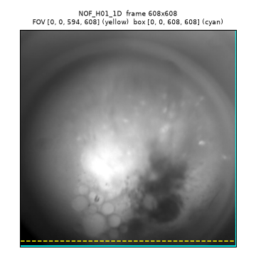
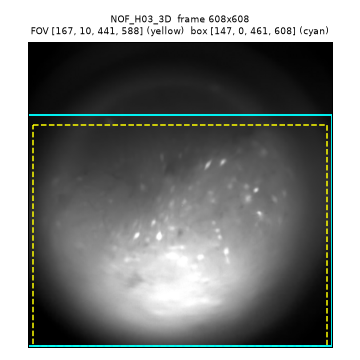
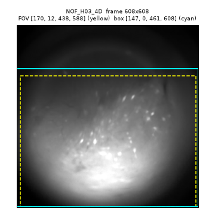
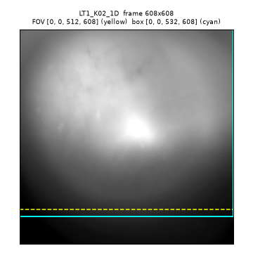
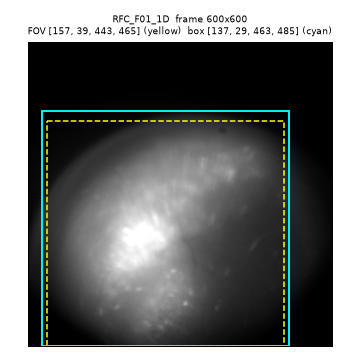
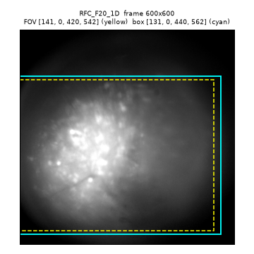
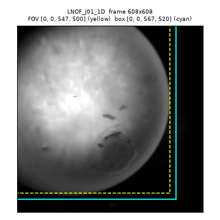

# Первый сквозной прогон bearmind на реальных данных (задача 17)

2026-10-31 — 2026-11-01. Ветка `bearmind-batch`, база 4311849. Окружение `bearmind` (CaImAn 1.13.2, NumPy 2.5.4, OpenBLAS с обходом Sandybridge). Машина: 32 логических ядра (16 физических), 191 ГиБ ОЗУ, на старте свободно 158 ГиБ.

Метки: **[изм]** — измерено в этом прогоне; **[вывод]** — расчёт или экстраполяция, не измерено.

## Что решить

1. **Видео для просмотра (превью) занимают больше всего времени и диска.** Два dF/F-видео (контрастная версия фильма, три панели рядом) — 41% времени этапа MC (коррекции движения) и 0,1-0,5 ГБ каждое на 5-10-минутную сессию; QC-видео после CNMF-E — 275 МБ на 2000 кадров [изм]. Для часовой сессии с рамкой 567x520 это ~1,3 ГБ на dF/F-видео и ~12 ГБ на QC-видео [вывод]. Варианты: (а) делать их с прореживанием по времени (tbin 4+) и в половинном разрешении; (б) делать по запросу из GUI, а в батче только raw/mc-превью; (в) оставить как есть. **Рекомендую (б)**, иначе (а). По умолчанию остаётся (в).
2. **Часовые сессии пока не готовы к запуску.** Автокроп LNOF_J01_1D дал рамку 567x520 (ручной кроп был 458x458). По формуле задачи 0.3 `compute_W` CNMF-E займёт ~148 ГиБ (float64) при бюджете 153 ГиБ — впритык [вывод]. Время по линейной экстраполяции: MC ~80 мин, карты порогов ~2,2 ч [вывод]. Нужно решить до запуска: ужать кроп на часовых сессиях (порог `fov_threshold_frac` или ручная рамка) и ускорить карты порогов (раздел «Куда уходит время MC», рекомендация 4).
3. **Двойной ML-фильтр.** После автоинспекции остаются компоненты с вероятностью ML ниже порога 0,72; экспорт (правило старого `batch_export`) их выкидывает: 194 -> 117 и 211 -> 94 нейрона [изм]. В сводке `autoinspect_n_final` и проверка `auto_deleted_frac` этого не видят. Вопрос к автору: так задумано? Задача 18 (сравнение со старым конвейером) может это подтвердить.

Остальное одной строкой: пул MC 16 вместо 31 процесса даёт ту же скорость при меньшей памяти; `run` после падения пишет `[OK]` без напоминания о упавших сессиях; `fps_outlier` срабатывает на каждой 20-кадровой сессии в серии, где есть и 30-кадровые.

## Итог

1. **Конвейер проходит все этапы на реальных данных после трёх исправлений.** Короткая серия (2 сессии по 2000 кадров) дошла до экспорта; повторный `run` ничего не делает (тест `test_e2e_real.py`: реестр байт в байт тот же, ни один этап не стартовал) [изм].
2. **Два исправления — несовместимость старого кода автоинспекции с NumPy 2**, без них автоинспекция падала на каждой сессии: `np.cross` для 2-векторов и комплексный тип у `np.linalg.eigvals` [изм]. Третье — ошибка метрики MC (сравнивались кадры и шаблон в разных пространствах), из-за неё каждая сессия получала ложное предупреждение [изм].
3. **Этап MC: 17-26 кадров/с на сессию; сам CaImAn — только 35% времени** [изм]. Остальное — dF/F-видео (41%), применение сдвигов в одном потоке (12%), превью (9%). Чтение и кроп сырого видео — 3800 кадров/с, не узкое место.
4. **CaImAn MC не масштабируется дальше ~8 процессов на этой машине.** Пул 31: 227 с, пул 16: 234 с, пул 8: 302 с, сдвиги совпадают точно [изм]. В пуле из 31 каждая задача тратит в 4 раза больше процессорного времени, чем в пуле из 4.
5. **Карты порогов медленнее MC: 12-22 кадра/с, один процесс, ~20 ГБ** [изм]. 7-21 минута на сессию длиной 5-10 минут.

## Почему этому можно верить

Прогон шёл через настоящий CLI (`python -m bearmind ...`) на копиях данных. Время этапов взято из реестра (поля `started`/`finished`), память — сэмплером psutil раз в 2-3 с по всему дереву процессов (RSS — рабочий набор, private — выделенная процессу память). Раскладка времени MC получена отдельным скриптом, который вызывает те же функции этапа по одной. Каждое исправление начато с падающего теста; быстрый набор тестов: 251 прошёл. Сырые замеры и источники каждого числа — в журнале прогона `.superpowers/sdd/2026-10-31-bearmind-batch-core/task-17-report.md`.

## Объём прогона и изменение рамок

По решению автора во время прогона (без долгих прогонов CNMF-E):
- **series1** (6 сессий, копии): скан, кроп, MC, карты порогов. Пороги не принимались: CNMF-E всех 6 сессий стоит в `WAITING thresholds` — так и проверено ожидание.
- **series_short** (новая): первые 2 чанка NOF_H01_1D и NOF_H03_3D (по 2000 кадров, файлы меток времени обрезаны до 2000 строк). Весь путь: скан -> run -> `thresholds accept-suggested` -> run -> `gate not-needed` -> run -> run. Единственный CNMF-E в задаче.
- **series_lnof** (часовая сессия, 107107 кадров): только скан и кроп.

## Скан: аномалии против ожидания [изм]

| Сессия | Кадров | FPS | Найдено | Ожидалось |
|---|---|---|---|---|
| LT1_K02_1D | 11674 (видео 11848) | 19.76 | `frames_ts_mismatch` warning: +174 кадра (1.5%), обрезано до меток; `fps_outlier` | `frames_ts_mismatch` — да |
| NOF_H01_1D | 11849 | 19.76 | `fps_outlier` (медиана серии 29.78) | чисто |
| NOF_H03_3D | 17861 | 29.78 | — | чисто |
| NOF_H03_4D | 17860 | 29.78 | — | чисто |
| RFC_F01_1D | 8935 | 29.78 | — | чисто (legacy UCLA) |
| RFC_F20_1D | 8934 | 29.79 | `dropped_frames` warning: 1 пропуск, 69 мс | `dropped_frames` — да |
| LNOF_J01_1D | 107107 | 29.75 | — | чисто |

- `fps_outlier` у 20-кадровых сессий — следствие того, что в тестовой серии смешаны 20 и 30 кадров/с; это предупреждение, сессии не исключаются.
- Старый `*_cropping.pickle` в папке LT1 сканом проигнорирован. Метки LNOF взяты из папки сессии (`LNOF_J01_1D_Mini_TS.csv`); копия в `0_TimeStamps` совпадает с ней построчно.
- Разделённой на части сессии в данных нет — этот путь на реальных данных не проверен.

## Кроп [изм]

Жёлтый пунктир — найденное поле зрения, голубая рамка — итоговая рамка мыши. NOF_H03_3D и NOF_H03_4D (одна мышь) получили одну рамку 461x608.

| | | |
|---|---|---|
|  |  |  |
|  |  |  |
|  | | |

- NOF_H01_1D освещён весь: кадр 608x608 без кропа (эталон CaImAn 1.11.3 тоже почти без кропа, 600x600).
- LT1_K02_1D: найденное поле — строки 0-512; старый ручной кроп срезал 100 строк снизу (строки 0-508). Расхождение 4 px; рамка 532x608 = поле + 2 x 10 px, прижата к верхнему краю кадра.
- LNOF_J01_1D: авто 567x520 охватывает весь круг линзы; ручной кроп был 458x458 и срезал края круга. Для часовой сессии это решает, влезет ли CNMF-E в память (см. «Что решить», п. 2).
- RFC_F20_1D: над рамкой остаётся тусклая ткань — порог 0.2 диапазона яркости её отрезает.

## Время и память по этапам

### series1: кроп, MC, карты порогов [изм]

Пул MC — 31 процесс у всех сессий (`n_cpus - 1`). Пик — по дереву процессов за время этапа.

| Сессия | Кадров, рамка | Кроп, с | MC, с | MC, кадр/с | MC пик RSS / private, ГБ | Пороги, с | Пороги, кадр/с | Пороги пик RSS, ГБ |
|---|---|---|---|---|---|---|---|---|
| LT1_K02_1D | 11674, 532x608 | 1 | 681 | 17 | 42.2 / 50.3 | 868 | 13 | 18.5 |
| NOF_H01_1D | 11849, 608x608 | 1 | 694 | 17 | 49.5 / 58.6 | 1027 | 12 | 19.6 |
| NOF_H03_3D | 17861, 461x608 | 2 | 752 | 24 | 47.9 / 59.4 | 1266 | 14 | 20.0 |
| NOF_H03_4D | 17860, 461x608 | 2 | 870 | 21 | 48.5 / 58.9 | 1275 | 14 | 19.9 |
| RFC_F01_1D | 8935, 463x485 | 9 | 346 | 26 | 27.0 / 33.6 | 411 | 22 | 15.4 |
| RFC_F20_1D | 8934, 440x562 | 10 | 389 | 23 | 28.4 / 35.3 | 476 | 19 | 17.8 |

Весь прогон series1 (MC + пороги, 6 сессий): 2 ч 31 мин, пик 49.5 ГБ RSS / 59.4 ГБ private, минимум свободной памяти системы 109 ГБ. Диск: сырое 2.3 ГБ -> `3_MC` 5.4 ГБ (FFV1, сжатие без потерь) + `Preview` 3.0 ГБ (из них dF/F 2.9 ГБ).

### series_short: весь путь, 2000 кадров [изм]

| Этап | NOF_H01_1D (608x608), с | NOF_H03_3D (463x608), с | Пик RSS / private, ГБ (больший из двух) |
|---|---|---|---|
| MC (пул 31) | 149 | 134 | 12.2 / 17.0 |
| Карты порогов | 259 | 174 | 13.7 / 18.7 |
| CNMF-E (пул патчей 31) | 315 | 248 | 26.5 / 33.1 |
| Автоинспекция | 59 | 9 | 25.3 / 36.2 (вместе с экспортом) |
| Экспорт | 1 | 1 | |

На 2000 кадрах время CNMF-E (6-8 кадр/с) определяется постоянными издержками (запуск пула, QC-видео); экстраполировать его на длинные сессии нельзя.

### series_lnof: часовая сессия [изм + вывод]

- Кроп 107107 кадров: 13.7 с, пик 0.7 ГБ RSS [изм].
- MC [вывод]: память пула не зависит от длины (куски по 500 кадров) — ~50 ГБ, как у series1. Время по линейной экстраполяции с NOF_H03_3D (кадры x пиксели x6.3): ~80 мин на этап, из них ~24 мин сам CaImAn.
- Карты порогов [вывод]: ~2.2 ч при нынешнем однопроцессном расчёте. Известная проблема задачи 10: при длинном T полосы `compute_init_maps` больше бюджета памяти (~30 ГБ на полосу против 19).
- CNMF-E [вывод]: пул патчей 5 процессов (`floor(152.96 / (245 x 0.107))`); `compute_W` 5.05 x T·d = 148 ГиБ в float64 (88 ГиБ в float32) при бюджете 153 ГиБ и 158 ГиБ свободных на старте. Сравнить пик с бюджетом задачи 0.3 по измерению нельзя: CNMF-E на часовой сессии не запускался.

## Куда уходит время MC [изм]

NOF_H03_3D, 17861 кадр, рамка 461x608; каждый шаг этапа отдельно, теми же функциями. Сумма 742 с (этап в прогоне — 752 с).

| Шаг | с | Доля |
|---|---|---|
| Чтение + кроп + временный TIFF | 6.0 | 1% |
| CaImAn `motion_correct` (31 процесс), из них ~30 с — запуск процессов и импорт CaImAn | 262.4 | 35% |
| Применение сдвигов кадр за кадром (один поток) | 92.5 | 12% |
| Запись FFV1 | 12.2 | 2% |
| Превью raw и mc (H.264) | 34.9 + 29.5 | 9% |
| dF/F-видео raw и mc, из них расчёт F0 ~10 с каждое | 146.2 + 155.0 | 41% |
| Корреляция с шаблоном, запуск/остановка пула | 3.7 | <1% |

Чтение сырых AVI без кропа — 4.7 с на 17861 кадр (3800 кадр/с): декодирование не узкое место.

**Масштабирование CaImAn MC** (тот же TIFF, процессы прогреты):

| Пул | Запуск + импорт, с | `motion_correct`, с | Одна задача (500 кадров), стена / CPU, с |
|---|---|---|---|
| 1 (в главном процессе) | — | — | 31.7 / — |
| 4 | — | 337* | 37 / 37 |
| 8 | 12.1 | 301.6 | — |
| 16 | 16.2 | 234.4 | — |
| 31 | 29.8 | 227.3 | 179 / 148 |

\* Пулы 4 и 31 в последнем столбце — отдельный скрипт, который отдаёт те же 36 задач CaImAn в пул напрямую (без построения начального шаблона); у пула 31 он дал 228 с против 227 с через `motion_correct`.

Сдвиги при пулах 31/16/8 совпадают до 0.000 px. В пуле из 31 задача тратит в 4 раза больше процессорного времени, чем в пуле из 4: машина упирается в пропускную способность — 16 физических ядер с SMT (два потока на ядро), вероятно память и кэш [вывод: причина не измерялась]. Ещё одна потеря: 36 кусков на 31 процесс дают второй круг из 5 кусков.

**Рекомендации (не делал, нужен отдельный шаг):**
1. Пул MC 16: время то же (234 против 227 с), память пула примерно вдвое меньше [вывод]. Число кусков делать кратным размеру пула.
2. dF/F-видео — см. «Что решить», п. 1: самый большой рычаг (41%).
3. Применение сдвигов — в потоках (OpenCV отпускает GIL); выигрыш ограничен тем же пределом пропускной способности [вывод].
4. Карты порогов: 5 значений gSig считаются по очереди в одном процессе. Параллелить по gSig (5 процессов по ~20 ГБ) или сузить `gsig_range`.

## Калибровка проверок

### MC — по 6 сессиям series1 (предварительно: 6 сессий, 5 мышей) [изм]

| Сессия | Макс. сдвиг, px | 99-й перцентиль, px | Корр. с шаблоном |
|---|---|---|---|
| LT1_K02_1D | 2.2 | 1.5 | 0.815 |
| NOF_H01_1D | 4.4 | 2.7 | 0.939 |
| NOF_H03_3D | 4.6 | 2.1 | 0.935 |
| NOF_H03_4D | 3.1 | 1.9 | 0.921 |
| RFC_F01_1D | 4.2 | 2.5 | 0.906 |
| RFC_F20_1D | 3.3 | 1.8 | 0.915 |
| (series_short, 2000 кадров) | 4.3 / 3.0 | | 0.944 / 0.960 |

Чувствительность корреляции: сдвиг всех кадров на 1/2/3/5 px снижает её с 0.94 до 0.88/0.75/0.61/0.41 (NOF_H01_1D) и с 0.82 до 0.73/0.57/0.43/0.25 (LT1_K02_1D) [изм].

Новые пороги (`bearmind/defaults.yaml`, раздел `checks`):
- `mc_max_shift_px`: warn 15 -> **10** (вдвое больше наибольшего наблюдённого 4.6 px); error **30** без изменений (у предела `max_shifts` 35 px: регистрация упёрлась в границу).
- `mc_template_corr`: warn 0.6 -> **0.7** (ниже минимума 0.82 на ~0.1; равномерный сдвиг на 2 px даёт 0.57-0.75). Старый порог был подобран под ошибочную метрику.

### CNMF-E, автоинспекция, экспорт — значения по умолчанию оставлены

Две сессии по 2000 кадров — не распределение; эти пороги нужно калибровать на производственных данных.

| Проверка | NOF_H01_1D | NOF_H03_3D | Порог (без изменений) |
|---|---|---|---|
| `cnmf_n_components_vs_median` | не считалась: 2 сессии < `min_sessions_for_relative` 3 | | warn 2.0, error 3.0 |
| `cnmf_missed_cells` | 4 | 2 | warn 20 |
| `auto_deleted_frac` | 0.134 | 0.032 | warn 0.8, error 0.95 |
| `export_n_neurons` | 117 | 94 | warn 30, error 5 |
| `export_median_snr` | 5.16 | 3.96 | warn 3.0 |

## CNMF-E на коротких клипах и эталон NOF_H01_1D [изм]

| | NOF_H01_1D, 2000 кадров | NOF_H03_3D, 2000 кадров | Эталон CaImAn 1.11.3, NOF_H01_1D целиком (11849) |
|---|---|---|---|
| Пороги (gSig / min_corr / min_pnr) | 4 / 0.90 / 11.0 (предложенные) | 4 / 0.78 / 13.5 (предложенные) | 4 / 0.92 / 7 |
| Компонент всего / принято | 260 / 224 | 301 / 218 | 239 / 199 |
| Медиана SNR принятых | 5.64 | 4.47 | 7.17 |
| После автоинспекции | 194 | 211 | — |
| Экспортировано | 117 | 94 | — |

Сравнение с эталоном некорректно: клип в 6 раз короче, пороги другие. Предложение порогов зависит от длины записи: на всей сессии NOF_H01_1D предложено 0.82 / 14.5, на клипе 2000 кадров — 0.90 / 11.0.

## Исправления

| # | Симптом | Причина | Исправление | Коммит |
|---|---|---|---|---|
| 1 | `mc_template_corr` 0.234 (warning) у LT1_K02_1D при сдвигах до 2.2 px | шаблон CaImAn построен по кадрам после пространственного фильтра (`gSig_filt`), а кадры брались сырыми | кадры фильтруются той же функцией CaImAn; на той же сессии 0.815 | 13f0dbb |
| 2 | автоинспекция падает на всех сессиях: `np.cross ... 2-dimensional` | NumPy 2.5 не принимает 2-векторы в `np.cross` (`polygon.get_convexities`) | z-компонента `a0*b1 - a1*b0`, то же, что `np.cross` давал раньше | a0218b4 |
| 3 | автоинспекция падает: `Unsupported pandas dtype: complex128` в EBM | `np.linalg.eigvals` в NumPy 2.5 всегда возвращает complex; `compute_eccentricity` CaImAn даёт комплексный столбец | своя `compute_eccentricity` в `auto_inspector.py` с поведением NumPy 1; на 260 футпринтах (пространственных масках компонент) совпадает с CaImAn 1.11.3 / NumPy 1.26 до 2e-15 | 475c2c7 |

Код CaImAn не менялся. Каждое исправление — с тестом, который падал до правки.

Проверено попутно [изм]: прерванный прогон (убит во время MC) при следующем запуске вернул этап в `pending`, удалил временную папку; недописанный `.partial.avi` заменён при повторной записи. `retry --all-failed` перезапускает упавшие этапы.

## Эквивалентность со старым кодом (задача 18)

Тест `tests/bearmind/test_equivalence.py` (маркеры `realdata`, `slow`). Клип: series_short, NOF_H01_1D, 2000 кадров. Тяжёлые прогоны выполняются один раз в отдельных процессах, результаты кэшируются в `%TEMP%\bearmind_equiv` (кэш сбрасывается при смене входа, параметров или кода обёрток). Повторный запуск всех четырёх проверок по кэшу занимает 35 с [изм].

| Проверка | Как сравнивали | Результат |
|---|---|---|
| MC | старый `DoMotionCorrection` на TIF с теми же кадрами и рамкой против этапа MC, те же параметры | сдвиги: макс. расхождение 1,9e-7 px (точность float32); кадры: 51,7% пикселей совпадают, 48,3% отличаются на +1, больше нет — этап округляет, старый код отбрасывает дробную часть [изм] |
| CNMF-E | старый `DoCNMF` против этапа: тот же вход, пул 31 процесс, 1 поток BLAS (библиотеки линейной алгебры) с обеих сторон, те же пороги 4 / 0.90 / 11.0, `fr` = точный FPS 19.758 | 260 и 260 компонент, сопоставлены все 260 (критерий ≥ 98%); футпринты и трейсы **совпадают бит в бит**; принято 224 и 224. Файл memmap (входной фильм CNMF-E на диске) у обеих сторон байт в байт одинаковый [изм] |
| ML | вероятности модели ebm_v9_iter8 пересчитаны тем же кодом (`_apply_ml_brain`) по признакам из старых processed-файлов | 131 файл старого окружения (CC 33, FOF 21, RFC 52, LT1 25), 36 274 оценённых компоненты, макс. расхождение 6,7e-16 [изм] |
| Схема экспорта | старый `batch_export.export_one` на копии processed-файла против `6_Export` | ключи npz и mat совпадают; json нового экспорта — надмножество (добавлены `autoinspection_fps`, `provenance`, `timestamps_file`) [изм] |

Время и память (дерево процессов, psutil раз в 1 с) [изм]: старый MC (пул 14) — 74 с, пик 12,9 ГБ; старый CNMF-E — 213 с, 26,4 ГБ; этап CNMF-E — 320 с (с QC-видео), 25,9 ГБ.

Попутно [изм]: старый экспорт того же файла тоже оставляет 117 нейронов (194 -> 117 по порогу ML 0,72) — как и новый. Двойной ML-фильтр из пункта 3 «Что решить» — правило старого `batch_export`, а не новшество конвейера.

**Две находки вне сравниваемого кода:**

1. **Старый кроп читал видео bonsai иначе, чем новый.** Сырые файлы bonsai — mpeg4 с цветовой субдискретизацией (yuv420p). Старый `DoCropAndRewrite` декодирует их в RGB и берёт красный канал; новый читатель берёт яркость (канал Y). Новые кадры ярче на 2 или 3 уровня серого в каждом пикселе (среднее +2,5), корреляция кадров ≥ 0,9999 [изм: NOF_H01_1D все 2000 кадров; NOF_H03_3D, NOF_H03_4D, LT1_K02_1D по 50 кадров]. У legacy-файлов (FFV1 в оттенках серого, RFC) разницы нет [изм]. Поэтому сравнение MC и CNMF-E выше проведено на одних и тех же кадрах. Влияние сдвига на CNMF-E не измерялось; скорее всего мало: сдвиг почти постоянный, его поглощает модель фона [вывод]. Нужно решение: оставить яркость Y (физически это и есть сигнал; рекомендую) и поправить комментарий в `bearmind/video.py` — или повторять старый красный канал.
2. **Гибель процесса пула CaImAn вешает прогон навсегда.** В одном из двух прогонов старого `DoCNMF` один рабочий процесс умер через ~44 с, пул запустил замену, и всё дерево процессов простаивало больше 3 минут, пока прогон не был остановлен [изм]. Результат одного патча (участка кадра, который CNMF-E считает отдельно) пропал: 79 предупреждений от патчей против 80 в удачном прогоне [вывод]. Причина гибели не найдена: в журнале Windows записи нет, трассировки нет. Этапы MC и CNMF-E используют тот же пул, а у runner нет ни таймаута этапа, ни проверки пула. Батч в такой ситуации повиснет с живым heartbeat [вывод]. В тесте добавлен сторож (при гибели процесса прогон прерывается с ошибкой); такой же нужен в этапах.

Не проверено: признаки автоинспекции, заново посчитанные в новом окружении из старых estimates (сверялись только вероятности по сохранённым признакам); полный старый путь «кроп -> MC -> CNMF-E» на сырых bonsai-файлах (из-за находки 1 вход не совпал бы).

## Что не проверено

- **Из-за изменения рамок:** CNMF-E, автоинспекция и экспорт на полных сессиях series1; всё после кропа на часовой сессии; пик памяти часовой сессии (только расчёт); сравнение NOF_H01_1D с эталоном 1.11.3 на той же длине и тех же порогах.
- Экспорт legacy-сессий (формат меток UCLA с заголовком) и экспорт сессии с `frames_ts_mismatch` (LT1) на реальных данных — эти сессии остановились на порогах.
- Разделённая на части сессия — в данных её нет.
- Ручная чистка (`gate ... cleaned`) — проверен только `not-needed`.
- Относительная проверка числа компонент — нужно 3+ сессии с CNMF-E.
- Причина плохого масштабирования CaImAn MC (память, кэш или SMT) — не измерялась.

## Файлы

- Отчёт-журнал с источниками чисел: `.superpowers/sdd/2026-10-31-bearmind-batch-core/task-17-report.md`
- Тест готовой серии: `tests/bearmind/test_e2e_real.py` (маркер `realdata`; `BEARMIND_TEST_SERIES=<серия>`)
- Пороги: `bearmind/defaults.yaml`, раздел `checks`
- Картинки кропа: `docs/superpowers/specs/e2e-2026-10-31/`
- Серии (сохранены для задачи 18): `H:\Projects\_bearmind_test\series1`, `series_short`, `series_lnof`
