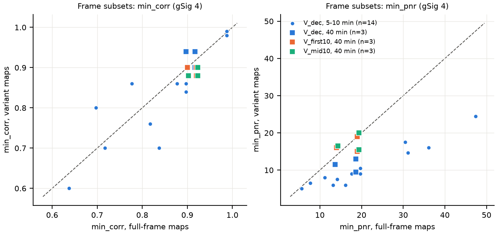
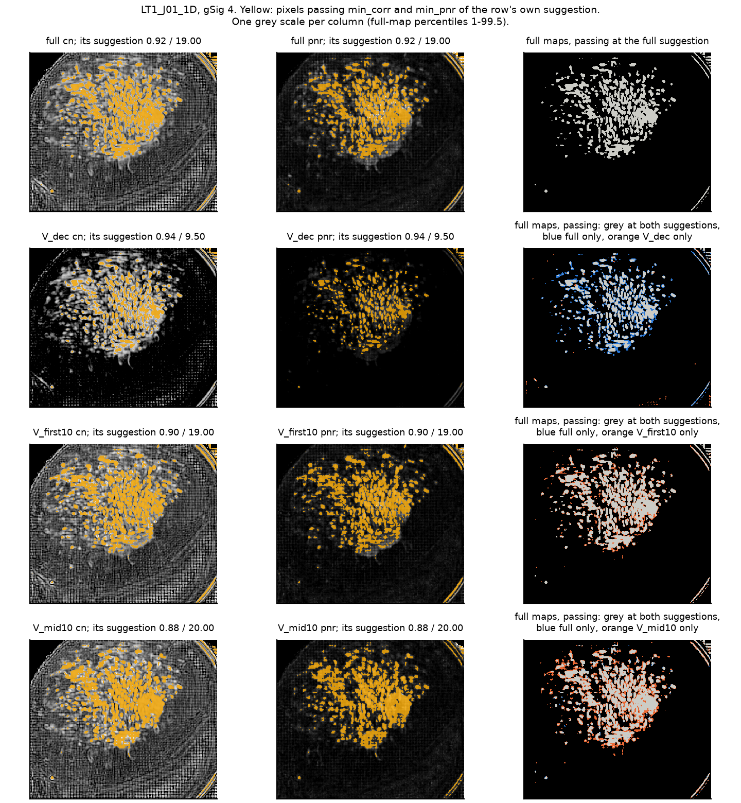
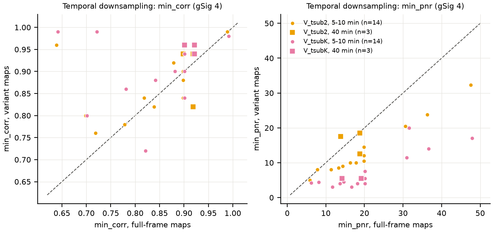
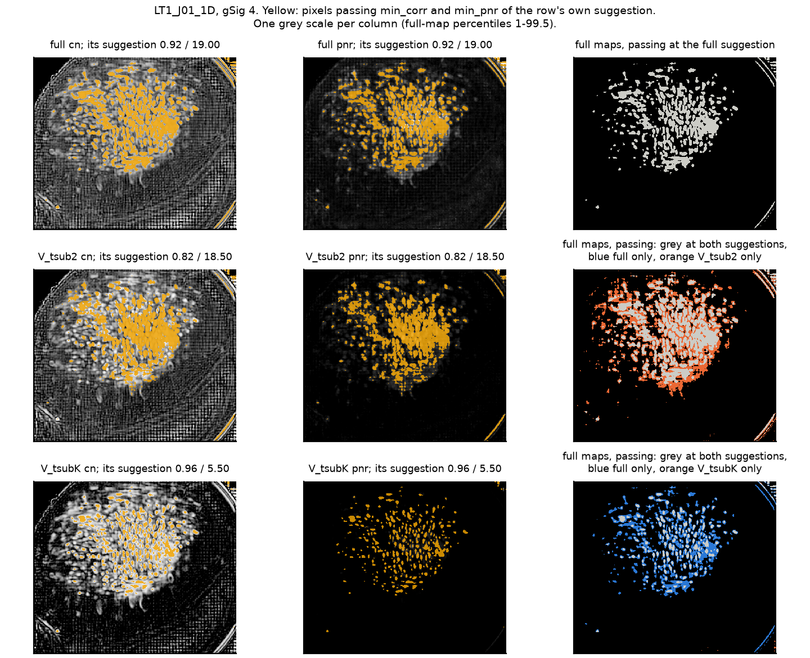

# Карты порогов по части кадров: меняются ли пороги

Дата: 2026-11-12. Код карт: `bm_qc.compute_init_maps` и `bearmind/stages/thresholds.py` основной папки; последняя правка этого кода — коммит e2dfa31 от 09.11, рабочая копия этих файлов чистая. Окружение `bearmind`. Скрипт: `experiments/maps_subsample_validation.py`. Батч LT1 шёл на той же машине. Мой расход памяти был ниже 25 ГБ (замер раз в 5 с — до 22,5 ГБ; сумма пиков рабочих процессов с запасом на основной — до 23 ГБ), процессов не больше 4.

## Ответ

Главная мера — что пороги, выбранные на картах варианта, сделают на картах full (их и считает CNMF-E). gSig подсказки во всех вариантах совпадает с full по построению: этап всегда предлагает gSig 4.

- **V_dec (каждый 5-й или 8-й кадр): пороги не те же.** Во всех 17 сессиях `min_pnr` подсказки ниже, чем на full: медиана Δ −9,5, худшее −23,2 (Δ = вариант − full). Яркий хвост PNR ×0,56 (0,49–0,82). `min_corr` сдвигается мало: медиана |Δ| 0,02, худшее 0,14. На картах full такая подсказка даёт ×1,63 затравок по медиане (×0,83–5,95). В 8 из 17 сессий доля ложных затравок (FDR) на full при ней 0,87–1,30, то есть ложных столько же, сколько настоящих; у подсказки full 0,00–0,13. Окно Thresholds при этом показывает обычное число пятен (×1,10 к full по медиане), так что глазом ошибку не видно.
- **V_first10 (первые 10 мин): близко, но не то же; проверено на 3 сессиях по 40 мин (одна мышь).** Δ `min_corr` −0,04…0,00, Δ `min_pnr` −4,0…+2,0. На картах full ×0,96–1,32 затравок; 69–100 % из них совпадают с затравками full, 90–96 % затравок full сохраняются. FDR на full 0,05–0,09 против 0,01–0,06 у full. Яркий хвост PNR ×0,72–0,85.
- **V_mid10 (10 мин из середины): то же, что V_first10.** Δ `min_corr` −0,04…−0,02, Δ `min_pnr` −3,5…+2,5, ×1,00–1,15 затравок, совпадение 80–92 % и 89–92 %, FDR 0,05–0,09. Начало сессии по этим трём сессиям не особое.
- **Даунсемплинг V_tsub2 и V_tsubK (отдельный вопрос: и карты, и CNMF-E с `tsub` = k).** Пороги с full на них не переносятся: `min_pnr` подсказки ниже на 6,5 (V_tsub2) и на 13,5 (V_tsubK) по медиане, яркий хвост PNR ×0,69 и ×0,33. Если же пороги подобраны на tsub-картах, а CNMF-E идёт с тем же `tsub`, то число затравок как у full (медиана ×1,00 и ×0,98). Совпадение с затравками full: V_tsub2 — 89 % в обе стороны по медиане (75–92 % и 52–94 %), V_tsubK — 66 % (52–85 % и 27–88 %).
- **Время карт.** Этап по всем кадрам на 40-минутной сессии: 6112–7998 с. Мои карты пяти gSig на LT1_J01_1D: V_dec 513 с, V_first10 1589 с, V_mid10 1578 с, V_tsubK 833 с. Настройки пула у меня другие, чем у этапа, так что прямого отношения времён эти числа не дают (раздел «Время»).

## Что нужно от автора

1. Решить, допустимо ли для подбора порогов то, что дают окна 10 мин: ×0,96–1,32 затравок у CNMF-E и FDR до 0,09 вместо 0,01–0,06. Для V_dec данные однозначнее: в 8 из 17 сессий FDR 0,87–1,30.
2. Решить, нужно ли больше длинных сессий до решения по окнам. Сейчас их 3, все от одной мыши и при 30 кадр/с. Длинных сессий при 20 кадр/с (J05, J27, J61) ещё нет. Скрипт дописывает результаты сам, команда в разделе «Как перезапустить».
3. Вопрос `tsub` — это решение о самом CNMF-E, не о картах. Если его поднимать, пороги надо подбирать на картах с тем же `tsub`, а начальные клетки совпадут с нынешними на 66–89 % (медианы).
4. Самая сильная непроведённая проверка: запустить CNMF-E с порогами вариантов и сравнить найденные компоненты, а не только затравки.

## Вопрос

Этап thresholds строит две карты на каждое gSig (радиус клетки в пикселях) от 3 до 7:
- **карта корреляции (cn)** — насколько пиксель во времени похож на соседей;
- **карта PNR** (peak-to-noise ratio, пик к шуму) — самый большой пик пикселя, делённый на его шум.

Карты строятся по всем кадрам MC-фильма так, как их видит инициализация CNMF-E (`tsub` 1). Человек выбирает `min_corr` и `min_pnr` по картам в окне Thresholds. Потом CNMF-E применяет эти числа к картам, которые он сам считает по всем кадрам. На LT1_J01_1D (71 461 кадр, 40 мин, 30 кадр/с) этап шёл 6112 с (1,7 ч), на LT1_J01_2D и LT1_J01_3D — 6436 и 7998 с.

Автор предложил строить карты по части кадров. Каждый вариант сравнивался с картами по всем кадрам той же сессии («full»).

Подвыборки кадров. Меняются только карты в окне; CNMF-E по-прежнему считает по всем кадрам.
- **V_dec** — каждый k-й кадр всей сессии. k = 5 при частоте ниже 25 кадр/с (около 20), k = 8 при 25 и выше (около 30).
- **V_first10** — первые 600 с, все кадры. Только для сессий длиннее 10 мин.
- **V_mid10** — 600 с из середины сессии, все кадры. Контроль: особое ли начало, или любое 10-минутное окно даёт то же.

Даунсемплинг по времени (добавлен по просьбе автора). Это другой вопрос: что будет, если и карты, и сам CNMF-E перейдут на `tsub` больше 1.
- **V_tsub2** — `compute_init_maps(tsub=2)` по всем кадрам.
- **V_tsubK** — `compute_init_maps(tsub=k)` по всем кадрам, k как у V_dec. V_dec против V_tsubK отделяет «каждый k-й кадр» от «среднего k кадров».

`tsub` в CaImAn — среднее блоков по `tsub` кадров. Инициализация сравнивает PNR прореженного фильма с `min_pnr·√tsub`, а `min_corr` не меняет (`initialization.py:1208-1211`, см. `2026-11-12-caiman-tsub-thresholds-sources.md`). `compute_init_maps(tsub=k)` делает то же: среднее блоков и PNR, делённый на √tsub. Поэтому карты V_tsub2 и V_tsubK — это то, что увидела бы инициализация CNMF-E с `tsub` 2 или k.

Новых вариантов я не добавлял. Причина в разделе «Почему меняется PNR»: у прореживания и у окна разные механизмы ошибки, и ни одна другая подвыборка кадров не убирает оба сразу.

## Что мерили

На gSig 4 для всех сессий: этап предлагает пороги только на нём (`config.fallback_gsig`). На LT1_J01_1D ещё и на gSig 3, 5, 6, 7 (кроме V_tsub2).

1. **Подсказка порогов.** Функция `_suggest` этапа, импортированная из кода: `bm_qc.suggest_init_thresholds` с gSiz = 4·gSig + 1, сначала метод `mirror_fdr`, если он не дал чисел — `robust_bg`. Подсказка на картах full и на картах варианта, разница Δ = вариант − full.
2. **Сходство карт.** Корреляция Пирсона r по пикселям для cn и PNR. «Яркий хвост»: медиана верхних 5 % значений карты, вариант / full. То же для зеркальных карт. Пиксели — только там, где ищутся затравки (`valid_mask`: без 5 px у края и без тёмных углов).
3. **Затравки на картах full.** Затравка — точка, с которой CNMF-E начинает искать клетку. `bm_qc.count_seeds` с `min_dist = 2·gSig`: тогда число затравок близко к числу начальных нейронов (см. docstring). Затравки на картах full (i) при подсказке full и (ii) при подсказке варианта. Совпадение — доля затравок (ii), рядом с которыми (до 2 px) есть затравка (i), и наоборот. Для подвыборок это главная мера: человек выбирает пороги на картах варианта, а CNMF-E применит их к картам full.
4. **Доля ложных затравок (FDR).** Зеркальные карты строятся по фильму с обратным знаком. Кальциевых вспышек в нём нет, его пики — шум. FDR — число затравок на зеркальных картах, делённое на число на настоящих (`bm_qc.evaluate_thresholds`). Считался на картах full при подсказке full и при подсказке варианта.
5. **Для tsub-вариантов ещё одна мера.** Затравки карт варианта при его собственной подсказке против затравок full при подсказке full: число и совпадение в обе стороны. Это приближённо показывает, начнёт ли CNMF-E с `tsub` = k с тех же клеток, что с `tsub` 1.
6. **Счётчики окна** (`bearmind.threshold_model.counters`, пятна от 2 px, по всему кадру, как в окне сейчас).
7. **Время** построения карт.

## Сессии

| Корень | Сессии | Длина | Частота, кадр/с | Кадров | Эталон full |
|---|---|---|---|---|---|
| `H:\Projects\LT1\CalciumData` | LT1_J01_1D, LT1_J01_2D, LT1_J01_3D | 40 мин | 29,8 | 71 461–71 466 | карты батча, сделаны 12.11 |
| `H:\Projects\_bearmind_test\lt1_J03_J06` | LT1_J03_1D…4D | 10 мин | 19,8 | 11 842–11 846 | карты теста, сделаны 09–10.11 |
| то же | LT1_J06_1D…4D | 10 мин | 29,8 | 17 855–17 856 | то же |
| `H:\Projects\_bearmind_test\series1` | LT1_K02_1D, NOF_H01_1D | 9,8–10 мин | 19,8 | 11 674–11 849 | пересчитаны мной |
| то же | NOF_H03_3D, NOF_H03_4D | 10 мин | 29,8 | 17 860–17 861 | то же |
| то же | RFC_F01_1D, RFC_F20_1D | 5 мин | 29,8 | 8 934–8 935 | то же |

Всего 17 сессий. V_first10 и V_mid10 считались только на трёх сессиях по 40 мин: у остальных окно 10 мин равно всей сессии. Корень `lt1_J03_J06` собран на тех же сырых данных, что J03 и J06 серии LT1.

Проверка эталона:
- Сохранённые карты батча и теста `lt1_J03_J06` сделаны после последней правки кода карт (09.11, e2dfa31), с `gsig_range` 3–7, `tsub` 1 и зеркальными картами. Их использовал как есть. Мой пересчёт LT1_J03_1D на gSig 4 совпал с сохранёнными картами до |Δ| 8,5·10⁻⁵ в cn и 7,6·10⁻⁶ в PNR.
- Карты `series1` сделаны 31.10–01.11, до правок файлов кода карт от 01–09.11 (параллельный пул, расчёт высоты полос, проверка места на диске, новая функция рядом). По `git diff` сам расчёт карт и его вызов в этапе в этих правках не менялись. Но по правилу задачи я пересчитал эталон (все сессии короче 20 000 кадров). Внутри поля поиска затравок пересчёт совпал с сохранёнными картами до |Δ| 0,0015 в cn и 3·10⁻⁵ в PNR. Подсказка та же. Расхождения есть только у края и в тёмных углах, где шум близок к нулю (`reference_check.csv`).
- Подсказка, посчитанная мной по картам full, совпала с подсказкой в реестре у всех 17 сессий.

## Результаты: подвыборки кадров

Таблица 1. Подсказка порогов и что она даёт на картах full, gSig 4. «r» в подсказке — метод `robust_bg`, без пометки — `mirror_fdr`. Затравки и FDR посчитаны на картах full. Совпадение: доля затравок при подсказке варианта, рядом с которыми есть затравка при подсказке full (вар.→full), и наоборот.

| Сессия | Мин | Вариант | Кадров | Подсказка full | Подсказка варианта | Δ corr | Δ pnr | Затравки на full: при full / при варианте | Совпадение вар.→full / full→вар. | FDR на full: при full / при варианте |
|---|---|---|---|---|---|---|---|---|---|---|
| LT1_J01_1D | 40 | V_dec | 8933 | 0,92 / 19,0 | 0,94 / 9,5 | 0,02 | −9,5 | 162 / 153 (×0,94) | 0,88 / 0,83 | 0,01 / 0,04 |
| LT1_J01_1D | 40 | V_first10 | 17868 | 0,92 / 19,0 | 0,90 / 19,0 | −0,02 | 0,0 | 162 / 169 (×1,04) | 0,91 / 0,94 | 0,01 / 0,06 |
| LT1_J01_1D | 40 | V_mid10 | 17868 | 0,92 / 19,0 | 0,88 / 20,0 | −0,04 | 1,0 | 162 / 175 (×1,08) | 0,82 / 0,89 | 0,01 / 0,06 |
| LT1_J01_2D | 40 | V_dec | 8934 | 0,92 / 19,0 | 0,90 / 13,0 | −0,02 | −6,0 | 165 / 203 (×1,23) | 0,74 / 0,92 | 0,01 / 0,08 |
| LT1_J01_2D | 40 | V_first10 | 17869 | 0,92 / 19,0 | 0,88 / 15,0 | −0,04 | −4,0 | 165 / 217 (×1,32) | 0,69 / 0,90 | 0,01 / 0,09 |
| LT1_J01_2D | 40 | V_mid10 | 17869 | 0,92 / 19,0 | 0,90 / 15,5 | −0,02 | −3,5 | 165 / 189 (×1,15) | 0,80 / 0,92 | 0,01 / 0,05 |
| LT1_J01_3D | 40 | V_dec | 8934 | 0,90 / 14,0 | 0,94 / 11,5 | 0,04 | −2,5 | 185 / 154 (×0,83) | 0,84 / 0,70 | 0,06 / 0,04 |
| LT1_J01_3D | 40 | V_first10 | 17872 | 0,90 / 14,0 | 0,90 / 16,0 | 0,00 | 2,0 | 185 / 178 (×0,96) | 1,00 / 0,96 | 0,06 / 0,05 |
| LT1_J01_3D | 40 | V_mid10 | 17872 | 0,90 / 14,0 | 0,88 / 16,5 | −0,02 | 2,5 | 185 / 185 (×1,00) | 0,92 / 0,92 | 0,06 / 0,09 |
| LT1_J03_1D | 10 | V_dec | 2370 | 0,90 / 20,0 | 0,86 / 10,5 | −0,04 | −9,5 | 114 / 434 (×3,81) | 0,26 / 0,98 | 0,03 / 1,02 |
| LT1_J03_2D | 10 | V_dec | 2369 | 0,90 / 18,0 | 0,84 / 9,0 | −0,06 | −9,0 | 133 / 508 (×3,82) | 0,25 / 0,95 | 0,00 / 1,20 |
| LT1_J03_3D | 10 | V_dec | 2370 | 0,88 / 20,0 | 0,86 / 9,0 | −0,02 | −11,0 | 129 / 522 (×4,05) | 0,25 / 0,99 | 0,05 / 1,26 |
| LT1_J03_4D | 10 | V_dec | 2369 | 0,90 / 20,0 | 0,90 / 9,0 | 0,00 | −11,0 | 118 / 380 (×3,22) | 0,31 / 1,00 | 0,06 / 0,96 |
| LT1_J06_1D | 10 | V_dec | 2232 | 0,99 / 47,7 r | 0,99 / 24,5 r | 0,00 | −23,2 | 213 / 216 (×1,01) | 0,99 / 1,00 | 0,01 / 0,02 |
| LT1_J06_2D | 10 | V_dec | 2232 | 0,99 / 31,4 r | 0,99 / 14,7 r | 0,00 | −16,8 | 237 / 239 (×1,01) | 0,99 / 1,00 | 0,13 / 0,15 |
| LT1_J06_3D | 10 | V_dec | 2232 | 0,99 / 36,5 r | 0,98 / 16,0 | −0,01 | −20,5 | 177 / 289 (×1,63) | 0,49 / 0,80 | 0,02 / 0,13 |
| LT1_J06_4D | 10 | V_dec | 2232 | 0,99 / 30,8 r | 0,98 / 17,5 | −0,01 | −13,3 | 205 / 273 (×1,33) | 0,62 / 0,82 | 0,02 / 0,17 |
| LT1_K02_1D | 10 | V_dec | 2335 | 0,78 / 13,5 | 0,86 / 6,0 | 0,08 | −7,5 | 22 / 109 (×4,95) | 0,12 / 0,59 | 0,00 / 0,87 |
| NOF_H01_1D | 10 | V_dec | 2370 | 0,82 / 14,5 | 0,76 / 7,5 | −0,06 | −7,0 | 152 / 904 (×5,95) | 0,17 / 0,99 | 0,00 / 1,10 |
| NOF_H03_3D | 10 | V_dec | 2233 | 0,84 / 11,5 | 0,70 / 8,0 | −0,14 | −3,5 | 261 / 702 (×2,69) | 0,36 / 0,98 | 0,01 / 1,30 |
| NOF_H03_4D | 10 | V_dec | 2233 | 0,70 / 16,5 | 0,80 / 6,0 | 0,10 | −10,5 | 218 / 634 (×2,91) | 0,34 / 1,00 | 0,00 / 1,22 |
| RFC_F01_1D | 5 | V_dec | 1117 | 0,64 / 8,0 | 0,60 / 6,5 | −0,04 | −1,5 | 173 / 222 (×1,28) | 0,77 / 0,99 | 0,00 / 0,10 |
| RFC_F20_1D | 5 | V_dec | 1117 | 0,72 / 6,0 | 0,70 / 5,0 | −0,02 | −1,0 | 209 / 222 (×1,06) | 0,92 / 0,98 | 0,02 / 0,07 |

Таблица 2. Сходство карт и счётчики окна, gSig 4. «Пятна» — связные группы пикселей от 2 px, прошедших оба порога (`threshold_model.counters`).

| Сессия | Вариант | r cn | r PNR | PNR верх 5 %: вар./full | cn верх 5 %: вар./full | r зерк. cn / PNR | PNR зерк. верх 5 % | Окно: пятна на картах варианта / на full / на full при подсказке варианта |
|---|---|---|---|---|---|---|---|---|
| LT1_J01_1D | V_dec | 0,95 | 0,98 | 0,54 | 0,995 | 0,88 / 0,86 | 0,52 | 238 / 164 / 254 |
| LT1_J01_1D | V_first10 | 0,93 | 0,90 | 0,85 | 1,004 | 0,92 / 0,84 | 0,92 | 177 / 164 / 155 |
| LT1_J01_1D | V_mid10 | 0,94 | 0,87 | 0,88 | 1,002 | 0,94 / 0,81 | 0,94 | 163 / 164 / 149 |
| LT1_J01_2D | V_dec | 0,95 | 0,98 | 0,53 | 0,995 | 0,87 / 0,86 | 0,51 | 175 / 200 / 254 |
| LT1_J01_2D | V_first10 | 0,90 | 0,79 | 0,74 | 1,004 | 0,91 / 0,70 | 0,81 | 218 / 200 / 209 |
| LT1_J01_2D | V_mid10 | 0,94 | 0,84 | 0,82 | 1,002 | 0,94 / 0,73 | 0,88 | 231 / 200 / 204 |
| LT1_J01_3D | V_dec | 0,95 | 0,98 | 0,52 | 0,994 | 0,88 / 0,87 | 0,50 | 225 / 233 / 284 |
| LT1_J01_3D | V_first10 | 0,91 | 0,82 | 0,72 | 1,002 | 0,91 / 0,64 | 0,81 | 237 / 233 / 212 |
| LT1_J01_3D | V_mid10 | 0,95 | 0,86 | 0,77 | 0,999 | 0,95 / 0,68 | 0,86 | 206 / 233 / 197 |
| LT1_J03_1D | V_dec | 0,89 | 0,94 | 0,58 | 0,983 | 0,89 / 0,89 | 0,56 | 174 / 182 / 1320 |
| LT1_J03_2D | V_dec | 0,90 | 0,94 | 0,57 | 0,986 | 0,90 / 0,90 | 0,56 | 205 / 226 / 1600 |
| LT1_J03_3D | V_dec | 0,90 | 0,93 | 0,57 | 0,985 | 0,91 / 0,88 | 0,54 | 216 / 191 / 1775 |
| LT1_J03_4D | V_dec | 0,89 | 0,92 | 0,56 | 0,982 | 0,90 / 0,89 | 0,54 | 179 / 179 / 1407 |
| LT1_J06_1D | V_dec | 0,94 | 0,97 | 0,54 | 0,999 | 0,93 / 0,96 | 0,52 | 332 / 302 / 315 |
| LT1_J06_2D | V_dec | 0,94 | 0,96 | 0,50 | 1,000 | 0,93 / 0,95 | 0,50 | 334 / 341 / 343 |
| LT1_J06_3D | V_dec | 0,94 | 0,97 | 0,49 | 0,999 | 0,92 / 0,95 | 0,48 | 494 / 231 / 468 |
| LT1_J06_4D | V_dec | 0,93 | 0,97 | 0,56 | 0,999 | 0,91 / 0,94 | 0,54 | 398 / 263 / 437 |
| LT1_K02_1D | V_dec | 0,84 | 0,74 | 0,54 | 0,922 | 0,83 / 0,69 | 0,54 | 45 / 111 / 549 |
| NOF_H01_1D | V_dec | 0,92 | 0,97 | 0,61 | 0,995 | 0,88 / 0,84 | 0,60 | 207 / 172 / 1892 |
| NOF_H03_3D | V_dec | 0,90 | 0,97 | 0,59 | 0,994 | 0,88 / 0,91 | 0,58 | 287 / 427 / 1055 |
| NOF_H03_4D | V_dec | 0,91 | 0,96 | 0,56 | 0,994 | 0,89 / 0,92 | 0,57 | 382 / 318 / 1208 |
| RFC_F01_1D | V_dec | 0,96 | 0,97 | 0,77 | 0,998 | 0,95 / 0,96 | 0,76 | 238 / 215 / 387 |
| RFC_F20_1D | V_dec | 0,96 | 0,98 | 0,82 | 1,000 | 0,96 / 0,97 | 0,82 | 244 / 202 / 211 |

Что видно:
- У V_dec яркий хвост PNR во всех сессиях ×0,49–0,82, а cn почти не меняется (×0,92–1,00). Поэтому подсказка `min_pnr` падает всегда, а `min_corr` — как получится.
- Последствия V_dec делят сессии на две группы. У 9 сессий (J01, J06, RFC) затравок на full ×0,83–1,63 и FDR 0,02–0,17. У 8 сессий (J03, NOF, K02) затравок ×2,7–6,0 и FDR 0,87–1,30. Простого правила, какая сессия куда попадёт, по этим данным не видно. У J06 подсказка full упирается в `min_corr` 0,99, и `min_pnr` там мало что решает. У RFC яркий хвост PNR упал меньше всех (×0,77–0,82).
- Окно Thresholds об этом не предупреждает. На картах V_dec при их подсказке пятен ×0,41–2,14 от full. На картах full при той же подсказке их ×1,01–11.
- У окон 10 мин PNR падает меньше (×0,72–0,88). Зато карта PNR окна хуже повторяет карту full: на тех же трёх сессиях r PNR 0,79–0,90 против 0,98 у V_dec. За 10 мин активны не все клетки сессии. Затравки карт окна при их собственной подсказке совпадают с затравками full только на 39–52 % (`own_overlap_*` в CSV).

Таблица 3. LT1_J01_1D по всем gSig. Подсказка выбирается на сетке (шаг 0,02 и 0,5, край сетки `mirror_fdr` 0,98 и 20) и иногда переходит на `robust_bg`. Поэтому малое изменение карт может сдвинуть подсказку скачком (gSig 6 у окон: 0,98 / 20 → 0,99 / 30).

| Вариант | gSig | Подсказка full | Подсказка варианта | PNR верх 5 %: вар./full | r cn | r PNR | Затравки на full: при full / при варианте | Совпадение вар.→full / full→вар. |
|---|---|---|---|---|---|---|---|---|
| V_dec | 3 | 0,80 / 16,5 | 0,80 / 8,0 | 0,54 | 0,924 | 0,967 | 268 / 491 | 0,55 / 1,00 |
| V_dec | 4 | 0,92 / 19,0 | 0,94 / 9,5 | 0,54 | 0,950 | 0,977 | 162 / 153 | 0,88 / 0,83 |
| V_dec | 5 | 0,98 / 20,0 | 0,96 / 18,0 | 0,56 | 0,964 | 0,982 | 92 / 124 | 0,50 / 0,67 |
| V_dec | 6 | 0,98 / 20,0 | 0,96 / 20,0 | 0,58 | 0,959 | 0,981 | 94 / 116 | 0,64 / 0,79 |
| V_dec | 7 | 0,99 / 53,4 | 0,98 / 19,0 | 0,60 | 0,955 | 0,979 | 43 / 91 | 0,35 / 0,74 |
| V_first10 | 3 | 0,80 / 16,5 | 0,80 / 16,5 | 0,85 | 0,928 | 0,880 | 268 / 268 | 1,00 / 1,00 |
| V_first10 | 4 | 0,92 / 19,0 | 0,90 / 19,0 | 0,85 | 0,929 | 0,896 | 162 / 169 | 0,91 / 0,94 |
| V_first10 | 5 | 0,98 / 20,0 | 0,98 / 20,0 | 0,85 | 0,934 | 0,907 | 92 / 92 | 1,00 / 1,00 |
| V_first10 | 6 | 0,98 / 20,0 | 0,99 / 30,9 | 0,86 | 0,937 | 0,913 | 94 / 49 | 0,51 / 0,27 |
| V_first10 | 7 | 0,99 / 53,4 | 0,99 / 39,2 | 0,86 | 0,943 | 0,918 | 43 / 55 | 0,78 / 1,00 |
| V_mid10 | 3 | 0,80 / 16,5 | 0,86 / 14,5 | 0,88 | 0,944 | 0,857 | 268 / 236 | 0,89 / 0,78 |
| V_mid10 | 4 | 0,92 / 19,0 | 0,88 / 20,0 | 0,88 | 0,945 | 0,875 | 162 / 175 | 0,82 / 0,89 |
| V_mid10 | 5 | 0,98 / 20,0 | 0,98 / 20,0 | 0,89 | 0,945 | 0,887 | 92 / 92 | 1,00 / 1,00 |
| V_mid10 | 6 | 0,98 / 20,0 | 0,99 / 29,5 | 0,90 | 0,945 | 0,893 | 94 / 49 | 0,51 / 0,27 |
| V_mid10 | 7 | 0,99 / 53,4 | 0,99 / 36,2 | 0,91 | 0,949 | 0,898 | 43 / 55 | 0,78 / 1,00 |
| V_tsubK | 3 | 0,80 / 16,5 | 0,84 / 4,5 | 0,29 | 0,949 | 0,961 | 268 / 276 | 0,82 / 0,84 |
| V_tsubK | 4 | 0,92 / 19,0 | 0,96 / 5,5 | 0,30 | 0,961 | 0,972 | 162 / 125 | 0,73 / 0,56 |
| V_tsubK | 5 | 0,98 / 20,0 | 0,96 / 8,5 | 0,31 | 0,967 | 0,978 | 92 / 125 | 0,50 / 0,67 |
| V_tsubK | 6 | 0,98 / 20,0 | 0,98 / 11,0 | 0,32 | 0,964 | 0,976 | 94 / 94 | 1,00 / 1,00 |
| V_tsubK | 7 | 0,99 / 53,4 | 0,98 / 12,0 | 0,34 | 0,960 | 0,970 | 43 / 91 | 0,35 / 0,74 |

Рисунки:
- `assets/maps-validation/suggestions_subset_variants.png` — подсказки full против подсказок вариантов по всем сессиям. Точки разных вариантов одной сессии сдвинуты по горизонтали на 0,8 % шкалы, чтобы не закрывали друг друга.
- `assets/maps-validation/maps_LT1_J01_1D_subset_g4.png` — карты cn и PNR LT1_J01_1D: full и три подвыборки, одна шкала серого на столбец, жёлтым пиксели, прошедшие свою подсказку. Справа — карты full: серым пиксели, прошедшие обе подсказки, синим только full, оранжевым только вариант.

## Результаты: даунсемплинг по времени

Здесь вопрос другой: CNMF-E тоже работал бы с `tsub` = k. Поэтому главная мера — «свои» затравки: карты варианта при его подсказке против карт full при подсказке full. Последний столбец показывает, что будет, если подобрать пороги на tsub-картах, а CNMF-E оставить с `tsub` 1.

Таблица 4. Даунсемплинг, gSig 4.

| Сессия | Мин | Вариант | Отсчётов | Подсказка full | Подсказка варианта | Δ corr | Δ pnr | Свои затравки: full / вариант | Совпадение своих вар.→full / full→вар. | Подсказка варианта на картах full: затравки, FDR |
|---|---|---|---|---|---|---|---|---|---|---|
| LT1_J01_1D | 40 | V_tsub2 (k 2) | 35731 | 0,92 / 19,0 | 0,82 / 18,5 | −0,10 | −0,5 | 162 / 149 | 0,75 / 0,69 | 200, 0,22 |
| LT1_J01_1D | 40 | V_tsubK (k 8) | 8933 | 0,92 / 19,0 | 0,96 / 5,5 | 0,04 | −13,5 | 162 / 154 | 0,59 / 0,56 | 125, 0,01 |
| LT1_J01_2D | 40 | V_tsub2 (k 2) | 35733 | 0,92 / 19,0 | 0,94 / 12,5 | 0,02 | −6,5 | 165 / 156 | 0,82 / 0,78 | 152, 0,03 |
| LT1_J01_2D | 40 | V_tsubK (k 8) | 8934 | 0,92 / 19,0 | 0,94 / 5,5 | 0,02 | −13,5 | 165 / 162 | 0,72 / 0,71 | 152, 0,03 |
| LT1_J01_3D | 40 | V_tsub2 (k 2) | 35733 | 0,90 / 14,0 | 0,94 / 17,5 | 0,04 | 3,5 | 185 / 142 | 0,75 / 0,58 | 150, 0,04 |
| LT1_J01_3D | 40 | V_tsubK (k 8) | 8934 | 0,90 / 14,0 | 0,96 / 5,5 | 0,06 | −8,5 | 185 / 156 | 0,60 / 0,51 | 122, 0,00 |
| LT1_J03_1D | 10 | V_tsub2 (k 2) | 5923 | 0,90 / 20,0 | 0,90 / 12,0 | 0,00 | −8,0 | 114 / 117 | 0,89 / 0,91 | 204, 0,40 |
| LT1_J03_1D | 10 | V_tsubK (k 5) | 2370 | 0,90 / 20,0 | 0,94 / 4,0 | 0,04 | −16,0 | 114 / 134 | 0,66 / 0,77 | 163, 0,36 |
| LT1_J03_2D | 10 | V_tsub2 (k 2) | 5921 | 0,90 / 18,0 | 0,88 / 10,0 | −0,02 | −8,0 | 133 / 143 | 0,80 / 0,86 | 269, 0,64 |
| LT1_J03_2D | 10 | V_tsubK (k 5) | 2369 | 0,90 / 18,0 | 0,90 / 4,0 | 0,00 | −14,0 | 133 / 158 | 0,68 / 0,80 | 254, 0,57 |
| LT1_J03_3D | 10 | V_tsub2 (k 2) | 5923 | 0,88 / 20,0 | 0,92 / 10,5 | 0,04 | −9,5 | 129 / 126 | 0,80 / 0,78 | 198, 0,55 |
| LT1_J03_3D | 10 | V_tsubK (k 5) | 2370 | 0,88 / 20,0 | 0,90 / 5,5 | 0,02 | −14,5 | 129 / 132 | 0,77 / 0,79 | 337, 0,82 |
| LT1_J03_4D | 10 | V_tsub2 (k 2) | 5923 | 0,90 / 20,0 | 0,84 / 14,5 | −0,06 | −5,5 | 118 / 92 | 0,92 / 0,72 | 262, 0,91 |
| LT1_J03_4D | 10 | V_tsubK (k 5) | 2369 | 0,90 / 20,0 | 0,84 / 7,5 | −0,06 | −12,5 | 118 / 91 | 0,85 / 0,65 | 626, 1,32 |
| LT1_J06_1D | 10 | V_tsub2 (k 2) | 8928 | 0,99 / 47,7 r | 0,99 / 32,3 r | 0,00 | −15,4 | 213 / 224 | 0,89 / 0,94 | 216, 0,02 |
| LT1_J06_1D | 10 | V_tsubK (k 8) | 2232 | 0,99 / 47,7 r | 0,98 / 17,0 | −0,01 | −30,7 | 213 / 248 | 0,52 / 0,62 | 324, 0,18 |
| LT1_J06_2D | 10 | V_tsub2 (k 2) | 8928 | 0,99 / 31,4 r | 0,99 / 20,1 r | 0,00 | −11,4 | 237 / 235 | 0,90 / 0,91 | 239, 0,15 |
| LT1_J06_2D | 10 | V_tsubK (k 8) | 2232 | 0,99 / 31,4 r | 0,98 / 20,0 | −0,01 | −11,4 | 237 / 195 | 0,74 / 0,62 | 278, 0,41 |
| LT1_J06_3D | 10 | V_tsub2 (k 2) | 8928 | 0,99 / 36,5 r | 0,99 / 23,8 r | 0,00 | −12,6 | 177 / 184 | 0,90 / 0,94 | 178, 0,02 |
| LT1_J06_3D | 10 | V_tsubK (k 8) | 2232 | 0,99 / 36,5 r | 0,98 / 14,0 | −0,01 | −22,5 | 177 / 216 | 0,53 / 0,66 | 289, 0,13 |
| LT1_J06_4D | 10 | V_tsub2 (k 2) | 8928 | 0,99 / 30,8 r | 0,99 / 20,4 r | 0,00 | −10,4 | 205 / 207 | 0,91 / 0,93 | 207, 0,03 |
| LT1_J06_4D | 10 | V_tsubK (k 8) | 2232 | 0,99 / 30,8 r | 0,98 / 11,5 | −0,01 | −19,3 | 205 / 238 | 0,61 / 0,71 | 273, 0,19 |
| LT1_K02_1D | 10 | V_tsub2 (k 2) | 5837 | 0,78 / 13,5 | 0,78 / 8,5 | 0,00 | −5,0 | 22 / 20 | 0,90 / 0,82 | 387, 0,93 |
| LT1_K02_1D | 10 | V_tsubK (k 5) | 2335 | 0,78 / 13,5 | 0,86 / 4,0 | 0,08 | −9,5 | 22 / 20 | 0,65 / 0,59 | 109, 0,87 |
| NOF_H01_1D | 10 | V_tsub2 (k 2) | 5925 | 0,82 / 14,5 | 0,84 / 9,0 | 0,02 | −5,5 | 152 / 159 | 0,88 / 0,92 | 267, 0,53 |
| NOF_H01_1D | 10 | V_tsubK (k 5) | 2370 | 0,82 / 14,5 | 0,72 / 4,5 | −0,10 | −10,0 | 152 / 202 | 0,66 / 0,88 | 1133, 1,22 |
| NOF_H03_3D | 10 | V_tsub2 (k 2) | 8931 | 0,84 / 11,5 | 0,82 / 8,0 | −0,02 | −3,5 | 261 / 260 | 0,90 / 0,89 | 454, 0,78 |
| NOF_H03_3D | 10 | V_tsubK (k 8) | 2233 | 0,84 / 11,5 | 0,88 / 3,0 | 0,04 | −8,5 | 261 / 255 | 0,76 / 0,74 | 255, 0,11 |
| NOF_H03_4D | 10 | V_tsub2 (k 2) | 8930 | 0,70 / 16,5 | 0,80 / 10,0 | 0,10 | −6,5 | 218 / 234 | 0,87 / 0,94 | 478, 0,78 |
| NOF_H03_4D | 10 | V_tsubK (k 8) | 2233 | 0,70 / 16,5 | 0,80 / 3,0 | 0,10 | −13,5 | 218 / 290 | 0,63 / 0,83 | 634, 1,22 |
| RFC_F01_1D | 5 | V_tsub2 (k 2) | 4468 | 0,64 / 8,0 | 0,96 / 8,0 | 0,32 | 0,0 | 173 / 98 | 0,92 / 0,52 | 69, 0,00 |
| RFC_F01_1D | 5 | V_tsubK (k 8) | 1117 | 0,64 / 8,0 | 0,99 / 4,4 r | 0,35 | −3,6 | 173 / 67 | 0,69 / 0,27 | 33, 0,00 |
| RFC_F20_1D | 5 | V_tsub2 (k 2) | 4467 | 0,72 / 6,0 | 0,76 / 5,0 | 0,04 | −1,0 | 209 / 211 | 0,91 / 0,93 | 193, 0,03 |
| RFC_F20_1D | 5 | V_tsubK (k 8) | 1117 | 0,72 / 6,0 | 0,99 / 4,2 r | 0,27 | −1,8 | 209 / 85 | 0,73 / 0,30 | 61, 0,00 |

Таблица 5. Сходство карт, gSig 4.

| Сессия | Вариант | r cn | r PNR | PNR верх 5 %: вар./full | cn верх 5 %: вар./full | Окно: пятна на картах варианта / на full |
|---|---|---|---|---|---|---|
| LT1_J01_1D | V_tsub2 | 1,00 | 0,99 | 0,70 | 1,002 | 162 / 164 |
| LT1_J01_1D | V_tsubK | 0,96 | 0,97 | 0,30 | 1,007 | 254 / 164 |
| LT1_J01_2D | V_tsub2 | 1,00 | 0,99 | 0,70 | 1,003 | 241 / 200 |
| LT1_J01_2D | V_tsubK | 0,96 | 0,97 | 0,29 | 1,008 | 246 / 200 |
| LT1_J01_3D | V_tsub2 | 1,00 | 0,99 | 0,69 | 1,002 | 217 / 233 |
| LT1_J01_3D | V_tsubK | 0,96 | 0,97 | 0,29 | 1,006 | 251 / 233 |
| LT1_J03_1D | V_tsub2 | 0,99 | 0,96 | 0,67 | 1,003 | 183 / 182 |
| LT1_J03_1D | V_tsubK | 0,95 | 0,91 | 0,39 | 1,008 | 231 / 182 |
| LT1_J03_2D | V_tsub2 | 0,99 | 0,96 | 0,66 | 1,003 | 214 / 226 |
| LT1_J03_2D | V_tsubK | 0,96 | 0,92 | 0,38 | 1,009 | 273 / 226 |
| LT1_J03_3D | V_tsub2 | 0,99 | 0,97 | 0,67 | 1,002 | 201 / 191 |
| LT1_J03_3D | V_tsubK | 0,96 | 0,91 | 0,38 | 1,006 | 222 / 191 |
| LT1_J03_4D | V_tsub2 | 0,99 | 0,96 | 0,66 | 1,001 | 126 / 179 |
| LT1_J03_4D | V_tsubK | 0,96 | 0,89 | 0,37 | 1,005 | 127 / 179 |
| LT1_J06_1D | V_tsub2 | 1,00 | 0,98 | 0,68 | 1,000 | 330 / 302 |
| LT1_J06_1D | V_tsubK | 0,96 | 0,96 | 0,29 | 1,001 | 396 / 302 |
| LT1_J06_2D | V_tsub2 | 1,00 | 0,99 | 0,67 | 1,000 | 360 / 341 |
| LT1_J06_2D | V_tsubK | 0,96 | 0,95 | 0,27 | 1,001 | 296 / 341 |
| LT1_J06_3D | V_tsub2 | 1,00 | 0,99 | 0,68 | 1,001 | 248 / 231 |
| LT1_J06_3D | V_tsubK | 0,96 | 0,97 | 0,26 | 1,002 | 339 / 231 |
| LT1_J06_4D | V_tsub2 | 0,99 | 0,98 | 0,73 | 1,001 | 284 / 263 |
| LT1_J06_4D | V_tsubK | 0,96 | 0,97 | 0,31 | 1,002 | 405 / 263 |
| LT1_K02_1D | V_tsub2 | 0,98 | 0,90 | 0,61 | 0,991 | 73 / 111 |
| LT1_K02_1D | V_tsubK | 0,90 | 0,76 | 0,31 | 0,975 | 40 / 111 |
| NOF_H01_1D | V_tsub2 | 0,99 | 0,99 | 0,69 | 1,011 | 177 / 172 |
| NOF_H01_1D | V_tsubK | 0,93 | 0,96 | 0,42 | 1,026 | 219 / 172 |
| NOF_H03_3D | V_tsub2 | 0,99 | 0,99 | 0,73 | 1,006 | 390 / 427 |
| NOF_H03_3D | V_tsubK | 0,89 | 0,94 | 0,34 | 1,017 | 397 / 427 |
| NOF_H03_4D | V_tsub2 | 0,99 | 0,99 | 0,71 | 1,005 | 313 / 318 |
| NOF_H03_4D | V_tsubK | 0,91 | 0,94 | 0,33 | 1,014 | 381 / 318 |
| RFC_F01_1D | V_tsub2 | 0,98 | 0,99 | 0,94 | 1,011 | 177 / 215 |
| RFC_F01_1D | V_tsubK | 0,89 | 0,93 | 0,50 | 1,023 | 85 / 215 |
| RFC_F20_1D | V_tsub2 | 0,98 | 0,99 | 0,95 | 1,007 | 228 / 202 |
| RFC_F20_1D | V_tsubK | 0,89 | 0,93 | 0,58 | 1,014 | 121 / 202 |

Что видно:
- Карты cn меняются мало (r 0,98–1,00 у V_tsub2 и 0,89–0,96 у V_tsubK, хвост ×0,97–1,03). PNR, даже после поправки на √tsub, ниже: хвост ×0,61–0,95 у V_tsub2 и ×0,26–0,58 у V_tsubK.
- Подсказка на tsub-картах при CNMF-E с тем же `tsub` даёт столько же затравок, что full (медиана ×1,00 и ×0,98). Совпадают они с затравками full на 89 % (V_tsub2) и 66 % (V_tsubK) по медиане.
- Худшие совпадения (V_tsub2 52 %, V_tsubK 27–30 % затравок full) — сессии RFC по 5 мин. Там подсказка на tsub-картах подняла `min_corr` с 0,64–0,72 до 0,96–0,99 (RFC_F01 у обоих вариантов, RFC_F20 у V_tsubK; у V_tsubK метод сменился на `robust_bg`). Затравок стало в 1,8–2,6 раза меньше. Карты cn при этом близки к full (r 0,89–0,98): скачет подсказка, а не карты.
- V_dec против V_tsubK при том же k: среднее k кадров снижает PNR сильнее, чем каждый k-й кадр (хвост ×0,33 против ×0,56), потому что усреднение снимает белый шум, а поправка √k рассчитана именно на него (раздел «Почему меняется PNR»).

## Почему меняется PNR

PNR пикселя = максимум отфильтрованного сигнала / шум `sn`. Шум CaImAn оценивает по верхней половине спектра пикселя, от 0,25 до 0,5 частоты Найквиста (половины частоты кадров). Берутся не больше 3072 отсчётов: по 1024 из начала, середины и конца ряда (`get_noise_fft`).

Отдельный замер на участке поля с клетками разделил PNR на максимум и шум (`experiments/maps_subsample_mechanism.py`). Шаги те же, что в `compute_init_maps`, gSig 4. «Клетки» — 5 % пикселей участка с самым высоким PNR на full, «фон» — нижняя половина. В таблице медиана отношения вариант / full.

| Сессия, участок | Вариант | Максимум (клетки) | Шум sn (клетки) | PNR (клетки) | Шум sn (фон) |
|---|---|---|---|---|---|
| LT1_J03_1D (20 кадр/с), 120×120 px | V_dec, k 5 | ×0,97 | ×1,78 | ×0,54 | ×1,74 |
| | V_tsubK, k 5 | ×0,94 | ×1,17 | ×0,35 | ×1,13 |
| LT1_J01_1D (30 кадр/с), 48×48 px | V_dec, k 8 | ×0,95 | ×1,81 | ×0,52 | ×1,67 |
| | V_tsubK, k 8 | ×0,93 | ×1,14 | ×0,29 | ×1,03 |
| | V_first10 | ×0,76 | ×0,93 | ×0,81 | ×0,95 |

Что это значит:
- **Каждый k-й кадр (V_dec).** Пики почти не теряются (×0,95–0,97). Оценка шума растёт в 1,7–1,8 раза. После прореживания остаётся 4 кадр/с, и полоса, где CaImAn ищет шум, сдвигается с 2,5–4,9 Гц (20 кадр/с) или 3,7–7,4 Гц (30 кадр/с) на 0,5–1 Гц. Там лежит мощность самих кальциевых сигналов и медленного фона. Оценка «шума» начинает включать сигнал, и PNR падает примерно вдвое.
- **Среднее k кадров (V_tsubK).** Белый шум после усреднения k кадров падает в √k раз (в 2,2–2,8 раза). Оценка же почти не падает (×1,03–1,17): в полосе снова сигнал. Затем PNR делится на √k, как в CaImAn. Итог ×0,29–0,35. CaImAn поправляет порог на √tsub, но эта поправка верна только для белого шума.
- **Окно 10 мин (V_first10).** Шум почти тот же (×0,93). Падает максимум (×0,76): за 10 мин клетка реже даёт свою самую большую вспышку, чем за 40 мин.

Отсюда и решение не добавлять вариантов. Окно меньшей длины теряет пики. Прореживание портит оценку шума. Подвыборка, которая сохранит и то и другое, должна содержать все кадры подряд и всю длину сессии, то есть быть самой full.

## Время

Этап по всем кадрам (реестр, от старта до конца, с декодированием, 5 gSig, до 4 процессов по 19 ГБ): LT1_J01_1D 6112 с, LT1_J01_2D 6436 с, LT1_J01_3D 7998 с; у сессий 5–10 мин 265–1275 с.

Мои карты:

| Сессия | Как считалось | V_dec | V_first10 | V_mid10 | V_tsubK | V_tsub2 |
|---|---|---|---|---|---|---|
| LT1_J01_1D | 5 gSig, стена пула | 513 с (3 × 6,5 ГБ) | 1589 с (2 × 10,2 ГБ) | 1578 с (2 × 10,2 ГБ) | 833 с (2 × 6,1 ГБ) | — |
| LT1_J01_1D | gSig 4, один процесс | — | — | — | — | 697 с (21 ГБ) |
| LT1_J01_2D | gSig 4, один процесс 12,7 ГБ | 101 с | 258 с | 275 с | 181 с | 1186 с |
| LT1_J01_3D | то же | 164 с | 324 с | 361 с | 175 с | 1493 с |

На коротких сессиях series1 я считал full и варианты одним пулом с одинаковой памятью (gSig 4). Карты full — 416–835 с, V_dec — 81–539 с.

Почему эти числа нельзя прямо делить друг на друга:
- У этапа и у меня разное число процессов и разная память на полосу. На длинной сессии этап режет кадр на полосы по 8 строк, и 3–5× работы уходит на поля фильтра (пункт 5 в `2026-11-11-lt1-feedback.md`). У прореженного фильма полосы шире, и эта потеря меньше.
- Батч шёл на той же машине, загрузка менялась.
- **Оценка шума зависит от разложения числа кадров на множители.** `get_noise_fft` делает БПФ (быстрое преобразование Фурье) для каждого пикселя по всему ряду, если в нём меньше 3072 кадров. Для длины с большим простым множителем это в 10–20 раз дольше: 1117 кадров — 716 мкс на пиксель, 1116 кадров — 36 мкс; 2335 кадров — 665 мкс, 2336 — 87 мкс; 3072 и больше — 57 мкс. Поэтому V_dec на RFC (1117 кадров) и K02 (2335 кадров) шёл почти столько же, сколько full: 358–539 с против 416–700 с. На длинных сессиях в рядах больше 3072 кадров, и эффекта нет.

Память: мой процесс с рабочими процессами по замерам раз в 5 с занимал до 22,5 ГБ (`var_pool_peak_gb` в CSV). Один рабочий процесс — до 21,8 ГБ, два одновременных — до 2 × 11,0 ГБ. Свободной памяти на машине всегда было больше 40 ГБ: иначе скрипт остановился бы сам.

## Ограничения

- Длинных сессий 3, все от одной мыши (J01), 30 кадр/с. Только на них проверены V_first10 и V_mid10. Длинных сессий 20 кадр/с не было: их карты батч ещё не сделал.
- Коротких сессий 14 от 7 мышей из 3 серий (LT1, NOF, RFC). Две из них (RFC) по 5 мин.
- Почти везде только gSig 4: на нём этап предлагает пороги. Все gSig 3–7 — только у LT1_J01_1D (без V_tsub2).
- CNMF-E не запускался. Затравки (`count_seeds` с `min_dist = 2·gSig`) — приближение начальных нейронов, а не итоговые компоненты.
- Подсказка ступенчатая (сетка, края сетки, смена метода, `robust_bg` упирается в 0,99). У J06 подсказка full — `robust_bg` с `min_corr` 0,99, и там `min_corr` почти не отсекает: это слабая проверка.
- Счётчики окна посчитаны по всему кадру, как окно делает сейчас. Если окно перейдёт на поле поиска затравок (в работе у контроллера), эти числа изменятся.
- Времена получены при работающем батче и с другими настройками пула, чем у этапа.
- Механизм (раздел «Почему меняется PNR») измерен на двух участках двух сессий.

## Как перезапустить

Скрипт дописывает строки в CSV и пропускает пары «сессия × вариант», которые там уже есть. Поэтому его можно запускать на сессиях, которые батч досчитает позже.

1. Откройте терминал в `C:\Users\User\PycharmProjects\bearmind`.
2. Проверьте, что свободно больше 40 ГБ памяти. Ниже этого порога скрипт остановится сам.
3. Запустите для одной длинной сессии (все варианты, gSig 4, 35–45 мин):
   `C:\Users\User\anaconda3\envs\bearmind\python.exe experiments\maps_subsample_validation.py --root H:\Projects\LT1\CalciumData --sid LT1_J01_4D --gsigs 4 --work <папка, где свободно 20 ГБ>`
4. Для всех готовых сессий серии уберите `--sid`. Сессии без готового этапа thresholds скрипт пропустит.
5. Для всех gSig 3–7 уберите `--gsigs 4`. Время вырастет примерно в 5 раз.
6. Ничего больше делать не нужно: таблицы `tables.md`, сводка `summary_by_variant.csv` и рисунки пересчитываются в конце каждого запуска.

Скрипт держит свой расход памяти ниже 25 ГБ и запускает не больше 4 процессов. Декодированный фильм он кладёт в `--work` и удаляет после сессии. Карты вариантов остаются там же (`mss_maps_*.npz`, 10–20 МБ на вариант). Повторный запуск берёт их вместо пересчёта.

## Файлы

- `experiments/maps_subsample_validation.py` — скрипт: карты вариантов, подсказки, сравнение, CSV, таблицы, рисунки. Папка `experiments/` в `.gitignore`: для коммита нужен `git add -f`.
- `experiments/maps_subsample_mechanism.py` — замер максимума и шума (раздел «Почему меняется PNR»).
- `docs/superpowers/specs/assets/maps-validation/maps_subsample_results.csv` — строка на сессию × вариант × gSig, все меры и времена.
- `docs/superpowers/specs/assets/maps-validation/summary_by_variant.csv` — сводка по вариантам (медианы и крайние значения).
- `docs/superpowers/specs/assets/maps-validation/tables.md` — те же таблицы по-английски, пересчитываются скриптом.
- `docs/superpowers/specs/assets/maps-validation/reference_check.csv` — пересчитанные карты full `series1` против сохранённых.
- Рисунки: `suggestions_subset_variants.png`, `suggestions_tsub_variants.png`, `maps_LT1_J01_1D_subset_g4.png`, `maps_LT1_J01_1D_tsub_g4.png` в той же папке.
- Карты вариантов (временные, вне репозитория): `mss_maps_*.npz` в рабочей папке `--work`.
