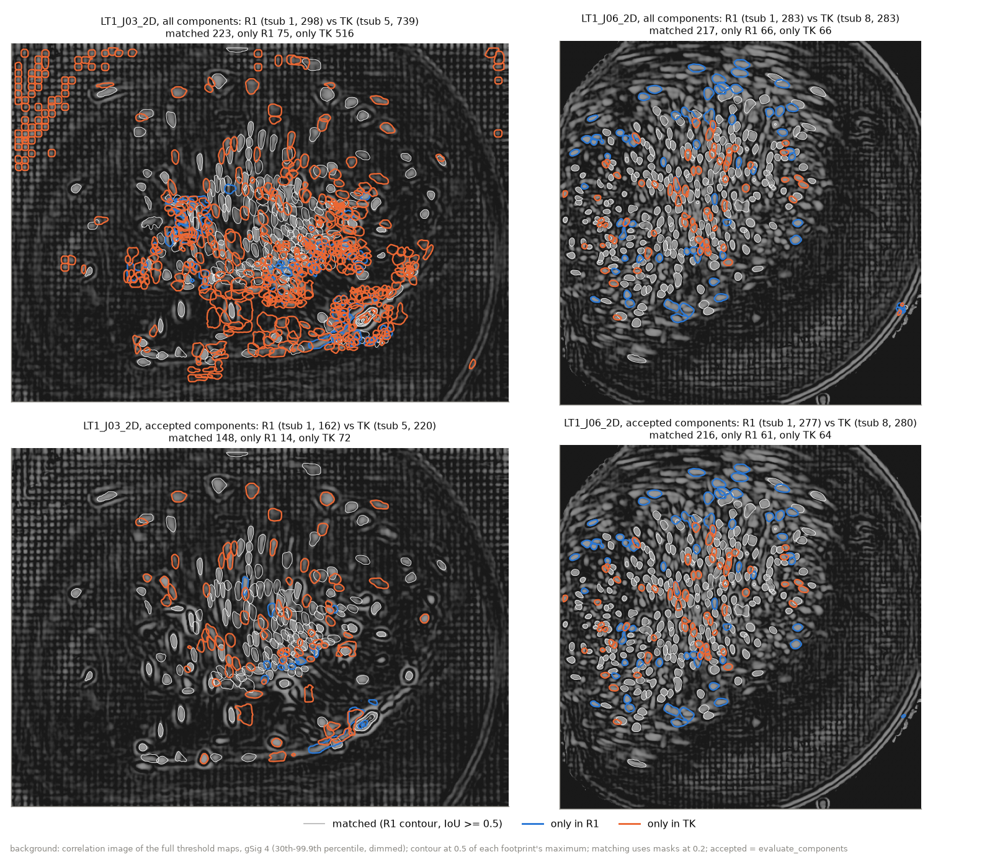
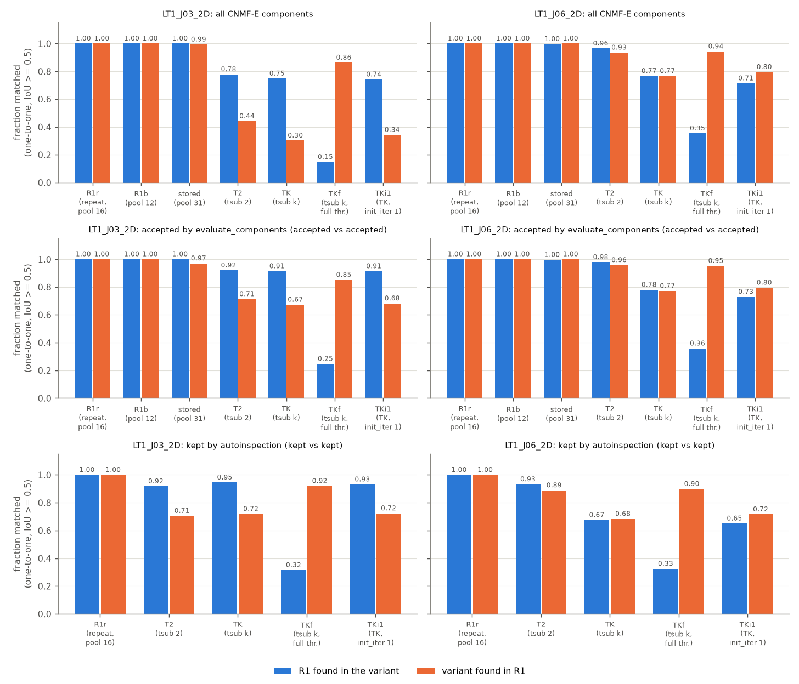
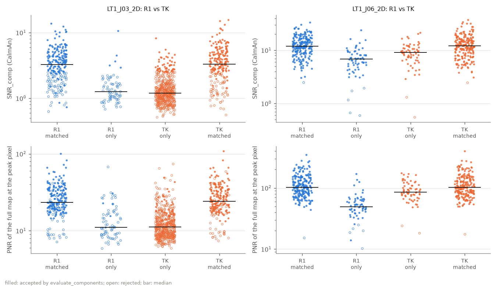
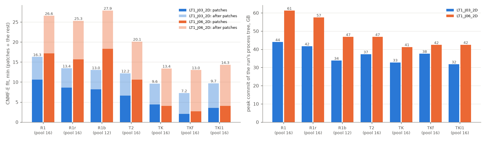

# CNMF-E с `tsub` 1 и `tsub` k на двух сессиях LT1

Дата: 2026-11-13. Скрипт: `experiments/cnmf_tsub_comparison.py`. Код этапа CNMF-E — основная папка, ветка `bearmind-batch` (последняя правка `bearmind/stages/cnmf.py` — e2dfa31, 09.11, только картинка `imax`). Окружение `bearmind`, CaImAn 1.13.2, OpenBLAS 0.3.34. Батч LT1 всё время шёл на той же машине, на этапе thresholds (сессии LT1_J17_1D…4D).

## Ответ

- **Нет, TK находит не те же клетки.** Повтор R1 и пул 12 вместо 16 дают битово тот же результат (и после автоинспекции тоже), а TK теряет 9-22 % принятых клеток R1 и добавляет свои.
- **LT1_J03_2D (k = 5):** 91 % принятых R1 есть среди принятых TK, но TK даёт 739 компонент вместо 298 и 220 принятых вместо 162. Лишние слабее совпавших (медианный SNR 2,9 против 4,0). После автоинспекции у TK 96 клеток против 73 у R1, 28 % клеток TK новые.
- **LT1_J06_2D (k = 8):** число то же (283), но 61 принятая клетка R1 (SNR 6,9, дальше от центра поля) заменена 64 другими (ближе к центру, корреляция 0,98 — ниже порога R1 0,99). После автоинспекции наборы совпадают на 67-68 %. Набор здесь решает край порога `min_corr`.
- **T2 ближе:** 92 % / 71 % принятых на J03_2D, 98 % / 96 % на J06_2D (доля R1 в варианте / доля варианта в R1).
- **Экономия TK при пуле 16:** `fit` в 1,4-2,1 раза быстрее (577 с против 780-977 с; 804 с против 1519-1672 с), пиковая память на 21-33 % меньше (33 ГБ против 42-44 ГБ; 41 ГБ против 57-61 ГБ). Ускоряется только проход по патчам. Остальная часть `fit` (5-10 мин, фон `compute_W` по всем кадрам) от `tsub` не зависит.

## Что нужно от автора

1. Решить, остаётся ли CNMF-E на `tsub` 1. Я рекомендую оставить: TK меняет набор клеток на 9-22 % принятых R1, а выигрыш — 1,4-2,1 раза по времени `fit` и 21-33 % по памяти. Если экономия нужна, ближе всего T2, но и он на J03_2D добавил 29 % принятых компонент.
2. Если `tsub` > 1 всё же нужен, этап надо доработать до запуска. В `memory.patch_gb_per_mframe` нет записей для `tsub` 5 и 8, и `patch_workers` падает. Поиск в остатке CaImAn при `tsub` k мягче порога с карт в √k раз (раздел «Проверка по коду»). Проверять надо на сессии 40 мин: там память важнее, а эти данные — 10 мин.
3. Решить, выяснять ли, почему R1 немного отличается от сохранённого результата конвейера (298 против 300 и 283 против 282 компонент). Пул 12, пул 16 и повтор дают битово одно и то же. Пул 31 проверить не удалось: рядом с батчем он не помещался в память. Проверка — R1 с пулом 31 на LT1_J03_2D, около 15 мин, при свободных ~110 ГБ.

## Вопрос

Автор спросил: можно ли подбирать пороги по каждому 5-му кадру и так же делать факторизацию. CaImAn не берёт каждый k-й кадр. CNMF-E с `tsub` = k усредняет блоки по k кадров и ищет клетки на прореженном фильме. Карты порогов автор решил оставить на всех кадрах. Здесь проверяется только сам CNMF-E: находит ли он с `tsub` k те же клетки, что с `tsub` 1, и что это экономит.

Проверка на картах (`2026-11-12-maps-subsample-validation.md`) показала: пороги с карт tsub-k дают столько же затравок, но совпадают с затравками full только на 66 % (k = 5 или 8) и 89 % (k = 2). Затравки — приближение. Здесь сравниваются итоговые компоненты CNMF-E.

## Проверка по коду: какой `min_pnr` передавать CNMF-E

CaImAn 1.13.2, `caiman/source_extraction/cnmf/initialization.py`.

1. Первый поиск клеток (`greedyROI_corr`, строки 1208-1211) сравнивает PNR прореженного фильма с `min_pnr · √(size(Y) / size(Y_ds))`. При `ssub` = 1 это `√(T / ⌈T/k⌉)`. `min_corr` не меняется.
2. `bm_qc.compute_init_maps(tsub=k)` усредняет блоки по k кадров так же, как `downscale` CaImAn (последний неполный блок — среднее имеющихся кадров), фильтрует и считает шум так же, как `init_neurons_corr_pnr`, и делит PNR на `√k`. Поэтому `min_pnr`, прочитанный с карт tsub-k, передаётся в CNMF-E как есть. Второй раз его масштабировать не нужно.
3. `√k` и `√(T/⌈T/k⌉)` расходятся не больше чем на 0,013 % (J03_2D, k = 5: 11 842 кадра, 2 369 блоков). Это намного меньше шага сетки подсказки.
4. `ssub` этапа равен 1 (`defaults.yaml`), поэтому пространственный множитель равен 1. `ssub_B` = 2 действует только на фон (`compute_W`) и на пороги не влияет. При `ssub` > 1 карты этапа перестали бы совпадать с тем, что видит CNMF-E.
5. **Расхождение, которого нет в картах.** После первого поиска CaImAn ищет клетки ещё раз, в остатке (`init_iter` = 2 по умолчанию, строки 1260-1273). Там стоит `min_pnr` без множителя `√k`, а PNR остатка считается по прореженному фильму. При `tsub` 1 оба поиска одинаковы. При `tsub` k второй поиск в единицах карт мягче в `√k` раз: J03_2D TK — 4,0 / √5 = 1,8 вместо 4,0; J06_2D TK — 20 / √8 = 7,1 вместо 20. Карты и окно Thresholds этот поиск не моделируют. Его вклад проверен вариантом TKi1 (TK без него).
6. Этап сейчас не может запустить CNMF-E с `tsub` 5 или 8: в `memory.patch_gb_per_mframe` есть только записи для 1 и 2, и `patch_workers` падает. Для T2, TK и TKf пул задан явно.

Пороги вариантов взяты из `docs/superpowers/specs/assets/maps-validation/maps_subsample_results.csv` (gSig 4) и сверены с конфигом сессий:

| Сессия | full (`tsub` 1) | карты tsub 2 | карты tsub k |
|---|---|---|---|
| LT1_J03_2D (11 842 кадра, 19,76 кадр/с, k = 5) | 0,90 / 18,0 (`mirror_fdr`) | 0,88 / 10,0 | 0,90 / 4,0 (`mirror_fdr`) |
| LT1_J06_2D (17 855 кадров, 29,78 кадр/с, k = 8) | 0,99 / 31,45 (`robust_bg`) | 0,99 / 20,08 (`robust_bg`) | 0,98 / 20,0 (`mirror_fdr`) |

Ограничения порогов:
- J03_2D TK 4,0 — не край сетки: сетка `min_pnr` у `mirror_fdr` идёт от 2,0 до 20,0 с шагом 0,5.
- J06_2D TK 0,98 / 20,0 — строгий угол сетки `mirror_fdr` (`min_corr` до 0,98, `min_pnr` до 20,0). Подсказка упёрлась в край, и подходящая точка может лежать строже.
- J06_2D full 0,99 — `robust_bg`, обрезанный до 0,99. У J06_2D корреляция выше 0,8 почти во всём поле, и набор клеток решает именно `min_corr` у самого края. Поэтому J06_2D проверяет в основном чувствительность к `min_corr`, а не к `tsub`.

## Метод

Скрипт повторяет путь этапа `bearmind/stages/cnmf.py`:
- конфиг серии собирается так же, как у runner (`config.resolve`), параметры — `cnmf_params(cfg, fps, (T, h, w))`. Для обеих сессий они совпали с параметрами сохранённого запуска в реестре;
- фильм: `decode_to_memmap` и `write_memmap` этапа. Один memmap на сессию для всех вариантов: это те же байты, которые этап пишет при каждом запуске;
- окружение этапа: `OPENBLAS_CORETYPE` до загрузки numpy, `OPENBLAS_NUM_THREADS=1` и `CAIMAN_TEMP` перед запуском пула;
- `pool.start_pool`, `CNMF(n, dview, params).fit`, `estimates.evaluate_components`.

Меняются только `tsub`, `min_corr`, `min_pnr` и размер пула. Карты остатка (`cnmf_qc`) не считались: на компоненты они не влияют. Картинка `imax` добавлялась только для автоинспекции, тем же способом, что в этапе (совпала с сохранённой до пикселя).

Каждый запуск идёт в отдельном процессе внутри job object Windows. Пиковая выделенная память (peak commit) — та же мера, что runner пишет в лог. Раз в 2 с записывались свободная память, память дерева процессов и память батча. Запуск начинался только при свободных 60 ГБ и прерывался бы при 15 ГБ. Прерываний и падений рабочих процессов не было: каждый вариант прошёл с первой попытки. Минимум свободной памяти — 21,9 ГБ (J06_2D R1).

Пул. Пул конвейера (31 процесс) на J06_2D занимает около 97 ГБ (лог runner). Батч LT1 рядом занимал до 91 ГБ по замерам раз в 2 с (медиана 49 ГБ), а его этап thresholds — до 101 ГБ по логу батча. Поэтому пул 31 не помещался. Все варианты, кроме R1b, шли с пулом 16.

Варианты на каждой сессии:

| Вариант | `tsub` | Пороги | Пул | Зачем |
|---|---|---|---|---|
| R1 | 1 | full | 16 | эталон |
| R1r | 1 | full | 16 | повтор R1: случайный разброс |
| R1b | 1 | full | 12 | другой пул: влияние пула |
| stored | 1 | full | 31 | сохранённый результат конвейера (10.11) |
| T2 | 2 | карты tsub 2 | 16 | |
| TK | k | карты tsub k | 16 | сценарий автора |
| TKf | k | full | 16 | пороги full без пересчёта |
| TKi1 | k | карты tsub k | 16 | TK без поиска в остатке (`init_iter` 1); проверка механизма, не настройка конвейера |

Компонента — то, что выдаёт CNMF-E. «Клетка» ниже — принятая или оставленная автоинспекцией компонента. Что это клетка, проверено только по SNR, `r_values` и картам, без ручной разметки.

Сравнение с R1:
1. Число компонент до и после `evaluate_components` («принятые»).
2. Совпадение компонент. Маска компоненты — пиксели выше 0,2 от максимума её футпринта. Мера — IoU масок (площадь пересечения, делённая на площадь объединения). Пары ищутся венгерским алгоритмом по 1 − IoU. Центроиды дальше 10 px не сравниваются (как `max_dist` в `register_ROIs`). Пара считается совпадением при IoU ≥ 0,5. Для сравнения посчитан и порог 0,3 (порог `register_ROIs` по умолчанию). Для принятых доли при нём выше не больше чем на 0,04. Для всех компонент на J03_2D — до 0,15: обрывки T2 и TK перекрывают клетки R1 слабо (CSV, столбцы `_iou0.3`).
3. «R1 в варианте» — доля компонент R1, у которых есть пара в варианте. «Вариант в R1» — наоборот. Для принятых: пара, в которой обе компоненты приняты.
4. Для совпавших пар: корреляция Пирсона трейсов C и футпринтов (по объединению носителей).
5. Для несовпавших: SNR и `r_values` CaImAn, размер маски, расстояние до края кадра, яркость среднего кадра, PNR и корреляция карт full в пикселе максимума футпринта. «Частичная» — несовпавшая компонента, у которой IoU ≥ 0,1 с какой-нибудь компонентой другого запуска.
6. Время `fit`: проход по патчам (до строки CaImAn «Elapsed time for processing patches») и остальное (слияние, фон `compute_W`, деконволюция). Пиковая выделенная память запуска.
7. Автоинспекция конвейера (`ae_launch.run_auto_inspection` с параметрами этапа) на R1, T2, TK, TKf и TKi1. Сравнивались компоненты, которые она оставила (`delete` = 0, как `n_kept` этапа).

## Результаты

### Уровень шума

| Сессия | Пара | Компонент | Принятых | R1 в варианте | Вариант в R1 | Принятые: R1 в варианте / вариант в R1 | Трейсы, r (медиана / 10-й процентиль) |
|---|---|---|---|---|---|---|---|
| LT1_J03_2D | R1r (повтор) | 298 | 162 | 1,00 | 1,00 | 1,00 / 1,00 | битово равны |
| LT1_J03_2D | R1b (пул 12) | 298 | 162 | 1,00 | 1,00 | 1,00 / 1,00 | битово равны |
| LT1_J03_2D | stored (пул 31) | 300 | 167 | 1,00 | 0,99 | 1,00 / 0,97 | 1,000 / 0,997 |
| LT1_J06_2D | R1r (повтор) | 283 | 277 | 1,00 | 1,00 | 1,00 / 1,00 | битово равны |
| LT1_J06_2D | R1b (пул 12) | 283 | 277 | 1,00 | 1,00 | 1,00 / 1,00 | битово равны |
| LT1_J06_2D | stored (пул 31) | 282 | 276 | 1,00 | 1,00 | 1,00 / 1,00 | 1,000 / 1,000 |

Что видно:
- При этих настройках CNMF-E детерминирован. Повтор и пул 12 вместо 16 дают битово те же A, C и тот же набор принятых.
- Сохранённый результат конвейера (пул 31, 10.11) почти тот же. На J03_2D у него 2 лишние компоненты (обе отвергнуты) и 5 компонент, принятых им, но отвергнутых в R1. На J06_2D у него нет одной принятой компоненты R1 (SNR 11): на её месте частично лежит другая (IoU 0,2). Причина не найдена. По коду CaImAn размер пула на результат влиять не должен (рабочие процессы считают патчи по одному, в один поток BLAS), и пул 12 против 16 это подтверждает. Пул 31 не проверен (см. «Что нужно от автора», пункт 3).
- Уровень шума поэтому — 0 при одинаковом окружении и до 3 % принятых между этой машиной сегодня и сохранённым запуском.

### Варианты против R1

Таблица 1. Компоненты и совпадение с R1 (IoU ≥ 0,5).

| Сессия | Вариант | `tsub` | Пороги | Компонент | Принятых | R1 в варианте | Вариант в R1 | Принятые: R1 в варианте / вариант в R1 | Принятые R1, найденные среди всех компонент варианта |
|---|---|---|---|---|---|---|---|---|---|
| LT1_J03_2D | R1 | 1 | 0,90 / 18,0 | 298 | 162 | — | — | — | — |
| LT1_J03_2D | T2 | 2 | 0,88 / 10,0 | 526 | 209 | 0,78 | 0,44 | 0,92 / 0,71 | 0,98 |
| LT1_J03_2D | TK | 5 | 0,90 / 4,0 | 739 | 220 | 0,75 | 0,30 | 0,91 / 0,67 | 0,97 |
| LT1_J03_2D | TKf | 5 | 0,90 / 18,0 | 51 | 47 | 0,15 | 0,86 | 0,25 / 0,85 | 0,27 |
| LT1_J03_2D | TKi1 | 5 | 0,90 / 4,0 | 644 | 217 | 0,74 | 0,34 | 0,91 / 0,68 | 0,96 |
| LT1_J06_2D | R1 | 1 | 0,99 / 31,45 | 283 | 277 | — | — | — | — |
| LT1_J06_2D | T2 | 2 | 0,99 / 20,08 | 292 | 283 | 0,96 | 0,93 | 0,98 / 0,96 | 0,98 |
| LT1_J06_2D | TK | 8 | 0,98 / 20,0 | 283 | 280 | 0,77 | 0,77 | 0,78 / 0,77 | 0,78 |
| LT1_J06_2D | TKf | 8 | 0,99 / 31,45 | 106 | 104 | 0,35 | 0,94 | 0,36 / 0,95 | 0,36 |
| LT1_J06_2D | TKi1 | 8 | 0,98 / 20,0 | 254 | 254 | 0,71 | 0,80 | 0,73 / 0,80 | 0,73 |

Таблица 2. Совпавшие пары и несовпавшие компоненты (IoU ≥ 0,5). SNR — `SNR_comp` CaImAn, медианы.

| Сессия | Вариант | Трейсы r: медиана / 10-й проц. | Футпринты r: медиана / 10-й проц. | Только в R1: всего / частичных / принятых, SNR принятых | Только в варианте: всего / частичных / принятых, SNR принятых | SNR совпавших в R1 |
|---|---|---|---|---|---|---|
| LT1_J03_2D | T2 | 0,98 / 0,83 | 0,99 / 0,77 | 66 / 65 / 4, 4,1 | 294 / 207 / 43, 2,9 | 3,1 |
| LT1_J03_2D | TK | 0,97 / 0,81 | 0,98 / 0,77 | 75 / 75 / 5, 3,6 | 516 / 293 / 55, 2,9 | 3,3 |
| LT1_J03_2D | TKf | 0,94 / 0,84 | 0,98 / 0,90 | 254 / 66 / 118, 3,7 | 7 / 6 / 7, 4,0 | 5,4 |
| LT1_J03_2D | TKi1 | 0,97 / 0,85 | 0,98 / 0,78 | 77 / 77 / 6, 4,1 | 423 / 279 / 52, 2,9 | 3,3 |
| LT1_J06_2D | T2 | 0,999 / 0,993 | 1,000 / 0,989 | 10 / 8 / 6, 8,6 | 19 / 10 / 11, 7,4 | 11,1 |
| LT1_J06_2D | TK | 0,995 / 0,945 | 0,997 / 0,945 | 66 / 33 / 61, 6,9 | 66 / 51 / 64, 9,3 | 11,9 |
| LT1_J06_2D | TKf | 0,993 / 0,955 | 0,997 / 0,957 | 183 / 42 / 178, 9,5 | 6 / 5 / 5, 6,7 | 13,9 |
| LT1_J06_2D | TKi1 | 0,996 / 0,955 | 0,997 / 0,951 | 81 / 35 / 75, 7,0 | 52 / 40 / 52, 9,5 | 12,2 |

Что видно на LT1_J03_2D:
- Почти все принятые клетки R1 в TK есть (97 % среди всех компонент, 91 % среди принятых). Из 14 принятых компонент R1, которых нет среди принятых TK, 9 есть в TK, но отвергнуты.
- TK добавляет много компонент. Из 516 лишних 461 отвергнуты `evaluate_components` (медианный SNR 1,1), 293 частично перекрывают компоненты R1. На рисунке это обрывки вокруг клеток и в фоне у ярких структур.
- 55 лишних компонент TK приняты. Они слабее совпавших: медианный SNR 2,9 против 4,0, PNR карт full в пикселе максимума 17,5 (порог R1 — 18,0). Только 10 из 55 проходят пороги R1 в этом пикселе.
- Поиск в остатке дал около 95 компонент из лишних (TK 739, TKi1 644). В тусклом углу кадра (средний кадр ниже половины медианы) у TK 62 компоненты, у TKi1 — 2. Все они отвергнуты. На принятые компоненты поиск в остатке почти не влияет (220 против 217). Основной избыток TK — от низкого `min_pnr` в первом поиске.
- Пороги full без пересчёта (TKf) теряют три четверти клеток: 51 компонента, 25 % принятых R1.

Что видно на LT1_J06_2D:
- TK находит столько же клеток, но 61 принятая клетка R1 (22 %) пропадает. По SNR и картам это не шум: медианный SNR 6,9, корреляция 0,99, 46 из 61 проходят пороги R1 в пикселе максимума. Они слабее совпавших (PNR 51 против 103) и дальше от центра поля (медиана 154 px против 107 px).
- Вместо них TK находит 64 другие принятые клетки, ближе к центру (94 px). PNR у них высокий (87), но корреляция 0,984, ниже порога R1 0,99. R1 их не видит из-за `min_corr`.
- Значит, на J06_2D набор клеток решает край порогов: `min_pnr` 20 на картах tsub 8 отсекает слабые клетки у края, а `min_corr` 0,98 вместо 0,99 добавляет клетки центра. Оба порога TK стоят в строгом углу сетки подсказки.
- Без поиска в остатке (TKi1) компонент меньше: 254 вместо 283, и совпадение хуже (73 % принятых R1).
- T2 почти совпадает с R1: 98 % и 96 % принятых.

### Автоинспекция

Таблица 3. Автоинспекция конвейера (модель `ebm_v9_iter8`, параметры этапа, `seed` 0) на принятых компонентах каждого варианта. «Оставлено» — `delete` = 0, как `n_kept` этапа. Совпадение оставленных — то же правило (IoU ≥ 0,5). Время — 1-2,5 мин на запуск, пик 37-38 ГБ.

| Сессия | Вариант | Принятых на входе | Слияний | Оставлено | Оставленные: R1 в варианте / вариант в R1 |
|---|---|---|---|---|---|
| LT1_J03_2D | R1 | 162 | 2 | 73 | — |
| LT1_J03_2D | stored (этап, 10.11) | 167 | — | 73 | не сравнивалось |
| LT1_J03_2D | R1r (повтор) | 162 | 2 | 73 | 1,00 / 1,00 (битово равны) |
| LT1_J03_2D | T2 | 209 | 6 | 95 | 0,92 / 0,71 |
| LT1_J03_2D | TK | 220 | 4 | 96 | 0,95 / 0,72 |
| LT1_J03_2D | TKf | 47 | 1 | 25 | 0,32 / 0,92 |
| LT1_J03_2D | TKi1 | 217 | 4 | 94 | 0,93 / 0,72 |
| LT1_J06_2D | R1 | 277 | 9 | 163 | — |
| LT1_J06_2D | stored (этап, 10.11) | 276 | — | 166 | не сравнивалось |
| LT1_J06_2D | R1r (повтор) | 277 | 9 | 163 | 1,00 / 1,00 (битово равны) |
| LT1_J06_2D | T2 | 283 | 5 | 171 | 0,93 / 0,89 |
| LT1_J06_2D | TK | 280 | 8 | 161 | 0,67 / 0,68 |
| LT1_J06_2D | TKf | 104 | 0 | 59 | 0,33 / 0,90 |
| LT1_J06_2D | TKi1 | 254 | 6 | 148 | 0,65 / 0,72 |

Что видно:
- Автоинспекция детерминирована: на повторе R1r она оставила битово те же клетки, что на R1. Уровень шума этого шага — 0.
- Число оставленных клеток R1 совпало с конвейером на J03_2D (73) и близко на J06_2D (163 против 166).
- На J03_2D автоинспекция убирает большую часть лишнего: у TK остаётся 96 клеток против 73 у R1. Из оставленных клеток R1 в TK есть 95 %. Но 27 из 96 клеток TK (28 %) в R1 нет.
- На J06_2D после автоинспекции наборы расходятся так же: оставленные клетки TK и R1 совпадают на 67-68 % (110 из 163 и из 161).
- T2 после автоинспекции расходится сильнее, чем до неё: на J06_2D 93 % и 89 % против 98 % и 96 % у принятых.

### Время и память

Таблица 4. Время `fit` и пиковая выделенная память запуска, пул 16 (R1b — 12). «После патчей» — слияние, фон `compute_W`, деконволюция. Батч LT1 был на этапе thresholds всё время.

| Сессия | Вариант | `fit`, с | Патчи, с | После патчей, с | Пик, ГБ | Пик в проходе по патчам / после, ГБ |
|---|---|---|---|---|---|---|
| LT1_J03_2D | R1 | 977 | 638 | 339 | 44,0 | 42,9 / 31,1 |
| LT1_J03_2D | R1r | 806 | 515 | 291 | 41,7 | 40,3 / 31,1 |
| LT1_J03_2D | R1b (пул 12) | 780 | 490 | 291 | 33,8 | 31,6 / 25,3 |
| LT1_J03_2D | T2 | 731 | 398 | 333 | 37,3 | 36,2 / 31,4 |
| LT1_J03_2D | TK | 577 | 266 | 311 | 32,8 | 31,4 / 31,7 |
| LT1_J03_2D | TKf | 434 | 122 | 312 | 37,6 | 35,8 / 27,0 |
| LT1_J03_2D | TKi1 | 582 | 213 | 369 | 31,8 | 31,4 / 31,5 |
| LT1_J06_2D | R1 | 1594 | 1032 | 562 | 61,3 | 60,4 / 40,5 |
| LT1_J06_2D | R1r | 1519 | 940 | 579 | 57,4 | 56,1 / 40,6 |
| LT1_J06_2D | R1b (пул 12) | 1672 | 1098 | 574 | 46,8 | 46,4 / 37,9 |
| LT1_J06_2D | T2 | 1207 | 634 | 573 | 46,8 | 45,6 / 40,5 |
| LT1_J06_2D | TK | 804 | 242 | 561 | 41,3 | 39,8 / 40,0 |
| LT1_J06_2D | TKf | 780 | 163 | 617 | 42,4 | 40,9 / 39,4 |
| LT1_J06_2D | TKi1 | 859 | 243 | 616 | 42,5 | 41,8 / 39,8 |

Что видно:
- Время одинаковых запусков R1 и R1r расходится на 5-21 % (загрузка машины батчем менялась). Отношения времён надо читать с этой точностью.
- `tsub` ускоряет только проход по патчам: в 1,8-2,4 раза на J03_2D (k = 5) и в 3,9-4,5 раза на J06_2D (k = 8). Время после патчей одно и то же у всех вариантов: 5-6 мин на J03_2D, 9-10 мин на J06_2D.
- Память. Пик R1 приходится на проход по патчам. У TK пик патчей опустился до уровня шага после патчей (`compute_W` по всем кадрам, 31-40 ГБ), и дальше `tsub` память не снижает. Рабочий процесс при `tsub` k всё равно держит патч на всех кадрах: второй шаг инициализации идёт по полному фильму (строки 1304-1344).
- Пул конвейера 31 занимает больше: 70-75 ГБ на J03_2D и около 97 ГБ на J06_2D (лог runner). Сколько при пуле 31 занял бы TK, здесь не измерено.

## Рисунки

- `assets/cnmf-tsub/contours_R1_vs_TK.png` — контуры R1 и TK на карте корреляции, обе сессии; сверху все компоненты, снизу принятые. Белым — совпавшие, синим — только в R1, оранжевым — только в TK.
- `assets/cnmf-tsub/contours_R1_vs_T2.png` — то же для T2.
- `assets/cnmf-tsub/matched_fractions.png` — доли совпадения для всех вариантов: все компоненты, принятые, оставленные автоинспекцией.
- `assets/cnmf-tsub/unmatched_snr_pnr_TK.png` — SNR и PNR карт full у совпавших и несовпавших компонент R1 и TK.
- `assets/cnmf-tsub/time_memory.png` — время `fit` (патчи и остальное) и пиковая память.

## Ограничения

- Две сессии по 10 мин, по одной мыши (J03, J06). Длинных сессий нет, а экономия памяти важна именно на них.
- Эталон — R1, то есть результат конвейера. Верного набора клеток нет. Можно сказать, чем наборы различаются, но не какой из них правильный.
- На J06_2D пороги стоят у края: full обрезан до 0,99, TK — в строгом углу сетки. Там результат решает в основном `min_corr`.
- Пул 16 вместо 31 конвейера. Пул 12 и 16 дают битово то же, поэтому на компоненты это, скорее всего, не влияет. Время и память при пуле 31 другие.
- Времена получены при работающем батче (этап thresholds, до 91 ГБ по замерам). Повтор R1 расходится по времени до 21 %. Батч один раз перезапустился (15:58, во время J06_2D R1r) и дальше шёл на том же этапе.
- Совпадение зависит от правила (маска 0,2 от максимума, IoU ≥ 0,5). При IoU ≥ 0,3 доли принятых меняются не больше чем на 0,04.
- TKi1 меняет `init_iter`, которого нет в настройках конвейера. Это только проверка механизма.
- Шаги после CNMF-E (`cnmf_qc`, превью, экспорт) не запускались.

## Как перезапустить

Скрипт пропускает варианты, у которых уже есть результат в рабочей папке.

1. Откройте терминал в `C:\Users\User\PycharmProjects\bearmind`.
2. Проверьте, что свободно больше 60 ГБ памяти. Ниже этого скрипт ждёт сам, а при 15 ГБ прерывает запуск.
3. Запустите варианты одной сессии (J03_2D — около 1,5 ч, J06_2D — около 2,5 ч):
   `C:\Users\User\anaconda3\envs\bearmind\python.exe experiments\cnmf_tsub_comparison.py run --sid LT1_J03_2D --variants R1 R1r R1b T2 TK TKf TKi1`
4. Удалите memmap сессии (12-20 ГБ):
   `... experiments\cnmf_tsub_comparison.py cleanup --sid LT1_J03_2D`
5. Запустите автоинспекцию (1-2,5 мин на вариант):
   `... experiments\cnmf_tsub_comparison.py autoinspect --sid LT1_J03_2D --variants R1 R1r TK T2 TKf TKi1`
6. Пересчитайте таблицы и рисунки: `... experiments\cnmf_tsub_comparison.py compare`.

Рабочая папка задаётся переменной `CNMF_TSUB_WORK`. По умолчанию — папка scratchpad этой сессии. Вариант R1p31 (R1 с пулом 31) в скрипте есть, но не запускался: он ждёт 110 ГБ свободной памяти.

Варианты R1r, TKi1 и автоинспекция добавлялись в скрипт по ходу работы. Запуски шли с замороженными копиями скрипта; путь `fit` во всех копиях один и тот же (проверено `diff`).

## Файлы

- `experiments/cnmf_tsub_comparison.py` — запуски, автоинспекция, сравнение, CSV, рисунки. Папка `experiments/` в `.gitignore`: для коммита нужен `git add -f`.
- `docs/superpowers/specs/assets/cnmf-tsub/cnmf_tsub_variants.csv` — строка на сессию × вариант: настройки, числа компонент, доли совпадения при IoU 0,5 и 0,3, пары, несовпавшие, время, память, этап батча.
- `docs/superpowers/specs/assets/cnmf-tsub/cnmf_tsub_components.csv` — строка на компоненту в каждом сравнении: пара, IoU, корреляции, SNR, `r_values`, размер, положение, яркость, карты full в пикселе максимума.
- Рисунки — в той же папке.
- Оценки, логи и записи памяти (вне репозитория): `<рабочая папка>\LT1_J03_2D\`, `<рабочая папка>\LT1_J06_2D\` — `<вариант>_estimates.pickle`, `<вариант>_run.json`, `<вариант>_mem.csv`, `<вариант>.log`, `ai_<вариант>\`.
