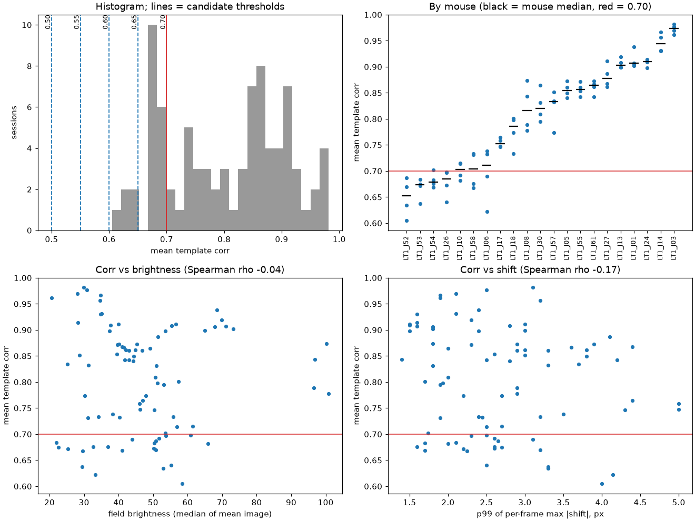

# Порог проверки "template corr" после MC: предложение

## Вывод и вопрос

Порог 0.70 отмечает 21 сессию из 84. Эти отметки не показывают движение.
Низкий corr (средняя корреляция кадров с шаблоном) — свойство мыши, а не сессии.

Рекомендую заменить 0.70 на два правила:

1. Абсолютный нижний предел: corr < 0.55.
2. Правило мыши: corr ниже медианы мыши больше чем на 0.05 (если у мыши 3 сессии или больше).

На LT1 оба правила вместе отмечают 3 сессии: LT1_J06_2D, LT1_J18_1D, LT1_J57_1D.
Предел 0.55 сейчас не отмечает ничего (минимум corr равен 0.605). Он нужен как защита от грубого сбоя.

**Вопрос: какой вариант выбрать?**

- A. Оба правила (рекомендую).
- B. Только абсолютный порог. Выберите значение из таблицы ниже.
- C. Оставить 0.70.

После вашего ответа: задача 16 (код порога) и `recheck` (повторная проверка) при остановке. MC не пересчитывается.

## Что показали данные

Все числа взяты из `template_corr_out.txt`.

- Диапазон corr: 0.605-0.981, медиана 0.832.
- Сдвиг (99-й перцентиль покадрового max |shift|) от 1.40 до 5.00 px, медиана 2.55 px. Ни у одной сессии он не выше 10 px (предел проверки сдвига).
- Отмеченные при 0.70 сессии: сдвиг 2.60 px, остальные 2.50 px. Разницы нет.
- Яркость поля у отмеченных 50.2, у остальных 44.8. Тусклые мыши не объясняют низкий corr.
- Ранговая корреляция (Spearman) corr с яркостью: rho = -0.043 (p = 0.7). С p99 сдвига: rho = -0.171 (p = 0.12). Связи нет.
- 21 отмеченная сессия лежит у 7 мышей из 21: J06, J10, J26, J52, J53, J54, J58. У J26, J52 и J53 ниже 0.70 все 4 сессии.
- Медианы corr у этих мышей: J52 0.652, J53 0.673, J54 0.679, J26 0.685, J10 0.703, J58 0.704, J06 0.711. У мыши J03 медиана 0.973.

Вывод: corr зависит от текстуры поля у данной мыши (сколько в кадре контрастных деталей). Движение здесь не главная причина.

## Кандидаты

| Правило | Отмечено сессий из 84 | Какие |
|---|---|---|
| corr < 0.50 | 0 | нет |
| corr < 0.55 | 0 | нет |
| corr < 0.60 | 0 | нет |
| corr < 0.65 | 5 | J06_2D, J26_1D, J52_1D, J52_2D, J53_4D |
| corr < 0.70 (сейчас) | 21 | 7 мышей, список в `template_corr_out.txt` |
| ниже медианы мыши больше чем на 0.05 | 3 | J06_2D (0.622), J18_1D (0.733), J57_1D (0.774) |
| ниже медианы мыши больше чем на 0.10 | 0 | нет |
| corr < 0.55 ИЛИ правило 0.05 (рекомендую) | 3 | J06_2D, J18_1D, J57_1D |

На рисунке: гистограмма corr с линиями кандидатов; corr по мышам; corr против яркости поля; corr против сдвига.

## Оговорка

Порог 0.7 откалиброван на 6 ярких сессиях (`defaults.yaml:119-121`). Там сдвиг на 2 px давал corr 0.57-0.75. Те сессии имели corr 0.82-0.94.
У мышей LT1 corr ниже без признаков движения (сдвиг 2.60 px, как у остальных). Поэтому один абсолютный порог не отделяет движение от особенностей поля.

Правило мыши тоже имеет предел. Оно не заметит сессию, если у мыши плохо все сессии сразу. Оно также не работает для новой мыши с менее чем 3 сессиями. Там остаётся только абсолютный предел.
Проверка сдвига (`mc_max_shift_px`, предел 10 px) остаётся независимой защитой. Сейчас она ничего не отмечает.
